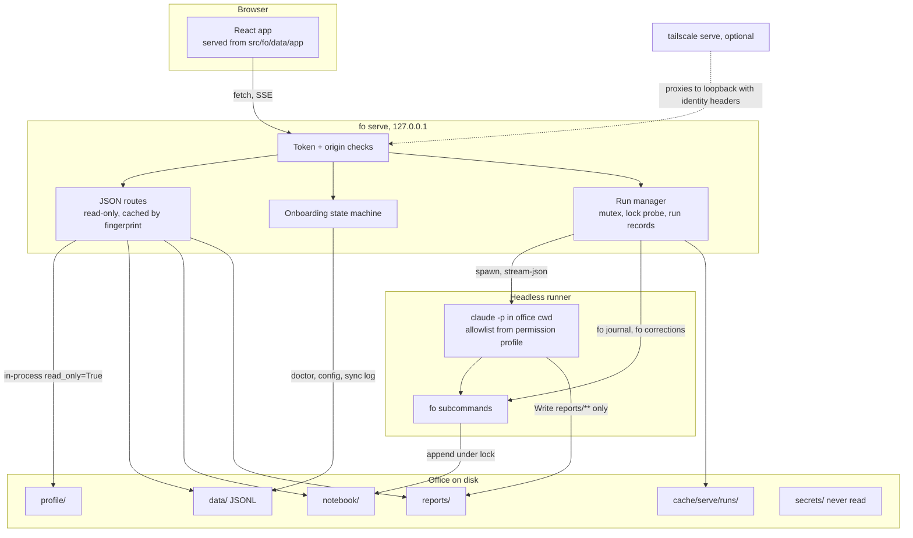
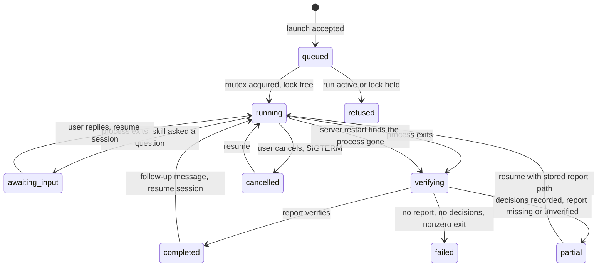
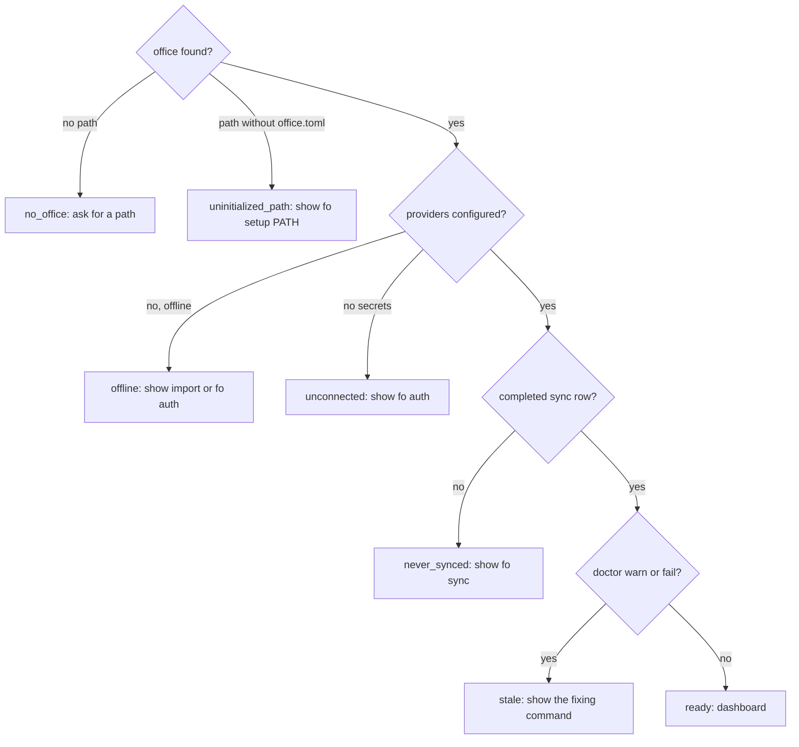

# Companion App - Plan

**Target repo:** `elliottrjacobs/family-office` (this checkout). The private office lives outside the repo; `office/` paths below refer to a user's own office root.

## Goal Capsule

- **Objective:** A person running `fo` can open a browser on their own machine and see their office (finances, reports, decisions, profile, sync health), be walked from "no office" to a synced one, and later talk to their advisors from the same place, without any of their data or credentials entering the public repo.
- **Means:** an optional `fo serve` command in the existing package that serves a prebuilt React dashboard and a read-only JSON API, with advisor chat added in a second phase through a headless Claude Code runner (KTD1, KTD2, KTD9).
- **Authority hierarchy:** this plan; then `AGENTS.md`, `SECURITY.md` and `src/fo/data/AGENTS.rules.md`; then the v2 plan at `docs/plans/2026-09-12-001-feat-family-office-plan.md` for conventions the companion app inherits.
- **Stop conditions:** stop and ask if any unit would require reading, copying, or fixturing a real office; if a unit would add a network listener beyond loopback without an explicit flag; if the agent runner would need `bypassPermissions` or an unscoped Write tool; if the coss ui or font licenses turn out not to permit redistribution (R19) and no system-font fallback satisfies the design.
- **Execution profile:** two phases on one branch, each unit a separate verified commit, CI green at every phase checkpoint. Phase 1 (U1 to U7) is read-only and ships first; Phase 2 (U8 to U11) adds chat. No feature flags: Phase 2 routes simply do not exist until their units land.
- **Tail ownership:** the implementing agent owns tests, CI changes, docs, the committed frontend build, and a smoke run of `fo serve` against a synthetic office. The user owns trying it against their real office and any `tailscale serve` setup on their own devices.

---

## Product Contract

### Summary

Add an optional companion web app to the public repo, started with `fo serve` from a user's office and opened at localhost. Phase 1 is a read-only dashboard plus guided onboarding; Phase 2 adds advisor chat that runs the existing skills headlessly and exposes journal and correction actions, all routed through `fo`. Remote access over a tailnet is a documented add-on, never the baseline.

### Problem Frame

The `fo` CLI and the 28 advisor skills work, but seeing the office means running commands or reading markdown in a terminal, and talking to an advisor means opening a coding agent in the office folder. A prototype built on claude.ai (artifact `DLR3tFGfRnWXbNtEgVHqNA`) showed that a chat-style app with a sidebar of advisors, a finances view drawn against the policy bands, a decision journal with a "needs verdict" tab, and a profile view that shows what each context level exposes is the right shape. The prototype is a design spec only: its state is in memory, its advisors and household are hardcoded sample data whose shapes do not match `fo --json`, it assembles advisor prompts in the browser with office data pasted in, and it depends on an artifact-only runtime for replies.

A v1 web app from before the `fo` rewrite ran on an always-on machine, listened on every interface, authenticated with a six-digit PIN in a year-long cookie, and ran the agent with permission checks bypassed. That app has been retired. The companion app must be usable by any `fo` user on one machine with nothing running in the background, and must not repeat that posture.

### Key Decisions

- **Local-first.** `fo serve` works on one machine with no tailnet, no always-on host, no extra install, started and stopped on demand. `(session-settled: user-directed — chosen over treating tailnet access as the baseline: not every user wants or has an always-on host.)` Governs R1, R2, R20.
- **No demo mode; guided onboarding instead.** The repo ships no sample household. A user with no office is guided to create one. `(session-settled: user-directed — chosen over a synthetic demo office: a demo would be a second thing to maintain and would not get the user closer to their own data.)` Governs R9, R10, R11, R12, R19.
- **Read-only dashboard ships before chat.** `(session-settled: user-approved — chosen over building dashboard and chat together: the read-only phase has no agent-runner risk and already delivers the visibility goal.)` Governs R3 to R8, R13.
- **Loopback bind by default; `tailscale serve` is the documented remote path; never a LAN-wide listener by default and never bypassed agent permissions.** `(session-settled: user-approved — chosen over the retired v1 app's posture of a 0.0.0.0 listener, a PIN cookie and bypassPermissions.)` Governs R20, R21, R22, R27. A non-loopback bind exists only behind an explicit flag with a printed warning (R22), for users who front the server with their own proxy.
- **The prototype's layout and coss ui styling are the design spec.** `(session-settled: user-approved — chosen over a fresh design: the prototype's information architecture was reviewed and accepted.)` Governs R14, R15, R16.
- **Chat invokes the skill itself in the office; the app never assembles advisor prompts from office data.** `(session-settled: user-approved — chosen over the prototype's client-side prompt: the skills already own context levels, report writing and journal entries, and a UI prompt would make UI runs and terminal runs diverge.)` Governs R23, R24, R25.
- **UI write actions exist in Phase 2 and go through `fo journal` and `fo corrections`.** `(session-settled: user-approved — chosen over a chat-only second phase.)` Governs R29, R30.
- **The built frontend is committed to the repo.** `(session-settled: user-approved — chosen over building in CI at release only: a plain git install must work without Node.)` Governs R17, R18.
- **No login on localhost; remote use adds tailnet identity; no mandatory PIN.** `(session-settled: user-approved — chosen over a login everywhere.)` Governs R20, R21, R22. Security review note: the per-launch token cookie is required on every route in every mode, because loopback is reachable by DNS-rebinding pages and by other OS users. The user never logs in: opening the URL that `fo serve` prints sets the cookie. The decision stands; "no login" means no credential entry, not no token.
- **Onboarding stays in the browser for status and guidance and sends the user to the terminal for credential entry and provider consent.** `(session-settled: user-approved — chosen over collecting credentials in the web app: `fo setup` and `fo auth` already own hidden prompts and the browser consent flow.)` Governs R10, R11.

### Requirements

**Serving and data**

- R1. `fo serve` starts an HTTP server bound to `127.0.0.1` on a configurable port (default 4790, never 8182, which the Schwab callback uses) and prints the URL to open.
- R2. The server works with nothing else running: no daemon, no tailnet, no Node, and exits cleanly on Ctrl-C.
- R3. Every office read the server performs runs in read-only mode: no provider calls, no cache writes, no index writes, and no lock acquisition; the only lock touch the server ever makes is the launch-time probe in R26.
- R4. The JSON API serves net worth, allocation against policy bands, positions, lots, cash flow, spend, goals, decisions, corrections, the reports list and report bodies, sync status, doctor results, public config, and the authored profile files, using the same functions and JSON encoding the CLI uses (decimals as strings, the `{reason, message}` error envelope).
- R5. The server serves only an explicit allowlist of office paths (`profile/`, `reports/` excluding part directories, `notebook/`, `data/sync_log.jsonl`) resolved through the existing containment helper, and never `secrets/`, `cache/`, `imports/`, `medical/`, `store.sqlite`, or lock files.
- R6. Report bodies are served as markdown text and rendered in the browser without raw HTML.
- R7. The API exposes the advisor registry derived from each skill's frontmatter, including a group for the sidebar, and the agent roster.
- R8. "Needs verdict", "breached", and "needs judgment" states are available without writing a review.

**Onboarding**

- R9. When `fo serve` cannot find an office, or is pointed at an uninitialized path, the page explains the state and shows the exact terminal command to run, then detects completion without a restart.
- R10. When the office exists but is offline, unconnected, or has never synced, the page shows which step is next (connect a provider with `fo auth`, place export files in `imports/` and run `fo sync --provider csv`, or run the first `fo sync` on the writer host) with the exact command, and never asks for a credential in the browser.
- R11. Onboarding surfaces doctor warnings and failures (token expiry, missing roles, stale sync) with the command that fixes each.
- R12. Onboarding states are derived from the office on disk, so a user who completes a step in the terminal sees the page advance on its next poll.

**Dashboard views**

- R13. Home shows sync status, stale accounts and providers, decisions needing a verdict, and today's briefing when one exists.
- R14. Finances shows net worth, allocation drawn against the IPS bands with over and under states, accounts with staleness, holdings with unknown basis left unknown, cash flow, and goals.
- R15. Reports lists every report with its frontmatter and opens a reader; Decisions shows needs-verdict, open and closed tabs plus standing corrections; Profile shows every authored file and which files each context level exposes, with no inline editing.
- R16. The sidebar groups advisors Household, Research, Specialists, Routine and Playbooks, and each advisor page shows its description, tier, default and allowed context levels, and declared commands.

**Packaging and public-repo hygiene**

- R17. Frontend source lives under `app/`; its production build is committed under `src/fo/data/app/` and ships in the wheel, so installing from a git tag gives a working UI.
- R18. CI rebuilds the frontend and fails if the committed build differs from the source.
- R19. The repo contains no household names, figures, account identifiers, addresses, PINs, tokens, or personal notes; fonts and component code are redistributed only under licenses that permit it, with a system-font fallback otherwise.

**Access control**

- R20. Local use needs no login. Every route in every mode requires the per-launch token cookie, which the browser receives by opening the URL `fo serve` prints; every request must carry a `Host` that is the bound loopback address with its port (`127.0.0.1` or `localhost`) or, with `--remote`, the tailnet name configured in `[serve]`, and every non-GET request must carry a same-origin `Origin`, so neither a rebinding page nor another OS user can read or drive the server.
- R21. With `--remote`, Tailscale identity headers are displayed and, when `[serve] allowed_logins` is configured, enforced: a login outside the list, or a missing header, is refused. The token remains the sole authenticator; identity headers only narrow access.
- R22. The server refuses to bind to a non-loopback address unless `--host` is given explicitly, and prints a warning when it is.

**Chat (Phase 2)**

- R23. Each advisor page offers a chat that starts a headless run of that skill in the office with a subject, a context level restricted to the skill's allowed levels, and a deep flag only where the skill declares it.
- R24. Before launch the page shows what the skill will read: the brief at the chosen level, active corrections, open subject decisions, the prior report path, and the estimated token count.
- R25. The run streams tool steps and text to the browser as they happen; follow-up messages resume the same session; the run survives a closed tab and can be reattached from any tab.
- R26. One run executes at a time; a launch is refused while the office lock is held or another run is active.
- R27. The runner is isolated to the office: it loads only the office's own project settings, no user-level settings, hooks or MCP servers; its allowlist is `fo`, Read scoped to the office, and Write and Edit scoped to `reports/**`; it denies reads of `secrets/`, `cache/`, `imports/`, `medical/`, `.git/` and the store, denies WebFetch, WebSearch, and shell access to curl, wget, python, ssh, open, osascript and git push; while the run marker is set, `fo` itself refuses setup, auth, sync, commit, schedule, notify, init, migrate, reindex and skills sync regardless of flag order or `uv run` prefix, and refuses `--office` or an `FO_OFFICE` that is not the marked office; permission prompts are answered "deny", never bypassed.
- R28. After a run the server verifies the report with the existing skill verifier and marks the run completed, partial, failed or cancelled; a partial run can be resumed with its original report path.
- R29. Give verdict, reopen, defer judgment, record a decision, and add or retire a correction are available from the UI, each a thin call to the matching `fo` command with a confirmation step and a stated rollback.
- R30. Decisions and corrections created from the UI carry the same fields as ones created by a skill (report path, context level, thesis, invalidation, conviction) and appear the same way in later briefs; only the `source` tag differs (`web`), so provenance is kept without changing how advisors read them.
- R31. Onboard and journal, the interview-style skills, are not launched from chat; onboard points to the terminal and journal is replaced by the record-decision form.

### Key Flows

- F1. First run with no office
  - **Trigger:** `fo serve` run outside any office, or `fo serve --office PATH` where PATH has no `office.toml`.
  - **Steps:** the server starts in onboarding mode and watches PATH, or asks for a path in the page when none was given; the page shows `fo setup PATH` (and the `--offline` and `--provider` variants) with what each does; the user runs it in a terminal; on the next poll the server finds `office.toml` and `profile/`, switches to office mode, and the page advances to the connection and sync steps.
  - **Covered by:** R9, R12.
- F2. Office exists but has never synced
  - **Trigger:** doctor reports no completed sync, or providers are empty.
  - **Steps:** the page shows connection status per provider from masked config and the account registry, the command to connect (`fo auth schwab`, `fo auth simplefin`) or to import (`fo sync --provider csv` after placing files in `imports/`), then `fo sync`, noting that sync runs only on the configured writer host; after a sync log row with a completed status appears the page shows the dashboard with the as-of time.
  - **Covered by:** R10, R11, R12.
- F3. Starting a chat and losing the tab
  - **Trigger:** the user sends a message on an advisor page.
  - **Steps:** the page shows the brief preview; the user confirms; the server records a run, launches the runner, and streams events to an append-only run log; the tab closes; the user reopens the advisor page and the server replays the log and continues streaming; on exit the server verifies the report and the run shows completed with a report link and any recorded decision cards.
  - **Covered by:** R23, R24, R25, R28.
- F4. Giving a verdict
  - **Trigger:** the user clicks Hit, Miss, Neutral or Unknown on a decision.
  - **Steps:** the page shows the decision, the outcome, and that closing is reversible with reopen; on confirm the server runs `fo journal close`; an `invalid_transition` error (already closed from another tab) is shown as such; the decision moves to Closed and the Home count updates.
  - **Covered by:** R29, R30.

### Success Criteria

- A new `fo` user can go from an empty folder to a dashboard showing their first sync by following only what the page tells them, without reading the README.
- With `--read-only` semantics in place, a tree hash of the office before and after an hour of dashboard use is identical.
- A decision recorded from the UI and one recorded with `fo journal add` in a terminal appear the same way in `fo brief` and `fo journal list`, differing only in the source tag.
- A run killed between `fo journal add` and the report write is shown as partial, and resuming it completes the report without a duplicate decision.
- The repo passes gitleaks and the office-path lint with the frontend committed.

### Scope Boundaries

- No trade execution, no money movement, no order placement of any kind.
- No credential entry, provider consent, `fo setup`, `fo auth`, `fo sync`, `fo schedule`, or `fo commit` from the browser.
- No editing of `profile/` from the UI; changes go through the Onboard skill in a terminal.
- No multi-user model: one office, one owner, optional allowlist of tailnet logins.
- No sample household, demo office, or fixture data served by the app.
- No always-on process: launchd or systemd definitions are not generated for the server.

#### Deferred to Follow-Up Work

- Codex runner adapter behind the same runner interface (`codex exec --json`, `codex resume`).
- `fo runs list` so agents can see run history, if run records prove useful to skills.
- A `fo report write` command so report bodies also pass through `fo`, removing the need for a scoped Write tool.
- An app-level notification when a scheduled sync fails.
- Dark-mode and phone-width polish beyond what the coss defaults provide.

---

## Planning Contract

### Key Technical Decisions

- KTD1. **The server is Python in the same package, using the standard library HTTP server.** The repo has no HTTP server dependency and leans toward minimal direct dependencies; stdlib `ThreadingHTTPServer` handles JSON routes, static files, and incrementally written streaming responses for Phase 2. If streaming proves unworkable in practice, add one small dependency in its own commit with the reason in `CHANGELOG.md`.
- KTD2. **Office reads are in-process calls with `read_only=True`; office writes are `fo` subprocesses.** Compute, notebook, reports, doctor, config and skills functions are plain functions taking a root path. Calling them directly avoids a process per request and inherits the output contracts. Writes shell out to `fo journal` and `fo corrections` so the lock, the `writable` gate, and the append-only validation apply unchanged (R3, R29). The error envelope and JSON encoding now inside `cli.run` and `cli.emit` move to a small `fo/envelope.py` that both the CLI and the server use; the serve package never imports `fo.cli`, because importing it builds the Typer app as a side effect. Subprocess writes invoke the same interpreter's `fo.cli` module, not a `fo` found on PATH, so server and CLI cannot disagree on version. API routes return the `--full` shape; list truncation stays a CLI presentation concern.
- KTD3. **The server never takes the office lock and never reindexes.** Read-only state projection does not lock; the first request on a stale index pays the projection cost. Responses are cached in memory keyed by the office fingerprint, which covers the content of `data/`, `notebook/`, `profile/` and `reports/` (the store file is not part of the key, so the scheduled sync's index rewrite is invisible and harmless). Because the full fingerprint reads every file, it is recomputed at most once per poll cycle behind a cheap stat signature (path, size, mtime), so an unchanged office costs one directory walk per cycle rather than a full read per route. The config, onboarding and status routes are never cached, because their inputs (`office.toml`, masked secrets presence, the sync log) are outside the fingerprint.
- KTD4. **Small read-only CLI commands are added rather than parsing files in the server:** `fo skills list --json` (frontmatter registry plus agent roster), `fo reports list --json` and `fo report show PATH --json` (over the existing scan), `fo status --json` (office path, last sync row, writer-host flag, and lock state only when `--lock` is passed), and `fo review --dry-run`. The dry run requires splitting `notebook.review` into `evaluate` (no lock, no writes, returns decision states and calibration) and `review` (lock, record, digest, output unchanged); the dashboard and the dry run call `evaluate` (R8). `fo start`, `fo report path` and `fo report parts` gain `--report PATH` so a resumed run, including its deep-mode part directory, can be pinned to its original report path (KTD12).
- KTD5. **Advisor grouping becomes skill metadata.** A `metadata.group` field (household, research, specialists, routine, playbooks) is added to all 28 skills and enforced by `scripts/lint_skills.py`, so the sidebar is generated, not hand-maintained (R7, R16).
- KTD6. **The "what each context level reads" table is defined in `brief.py` beside the code that builds each level**, with a test that fails when the brief's file set changes, and served to the frontend through a levels route rather than duplicated there.
- KTD7. **Onboarding is a server-side state machine over doctor, config, the account registry and the sync log.** States: `no_office`, `uninitialized_path`, `offline` (the registry holds `csv` accounts and no provider is connected; next step is placing files in `imports/` and `fo sync --provider csv`), `unconnected` (no secrets and no provider accounts; next step is `fo auth`), `never_synced` (providers present, no completed sync row; next step is `fo sync`, with a note when this machine is not the configured writer host), `stale`, `ready`. The page polls one status route; the server re-derives the state each poll, so terminal progress shows up without a restart (R12).
- KTD8. **Access control is a per-launch token cookie plus Host and Origin checks on every route.** `fo serve` generates a random token per process (so a restart rotates it), prints a URL carrying it once, and re-prints it on demand; the token is accepted only on a landing route that sets the cookie (`HttpOnly`, `SameSite=Strict`, `Secure` in remote mode) and redirects, never on API query strings, and the access log never records query strings. Every request's `Host` must be one of the accepted names with the port (`127.0.0.1` and `localhost` always; the `[serve] tailnet_name` additionally in `--remote`, so the same machine keeps working over loopback), else 421; every non-GET request must carry an `Origin` equal to the page's own, else 403; the cookie is compared in constant time and a stale cookie after a restart gets a page saying to open the printed URL. Tailscale identity headers are read only when `--remote` is set, shown in the UI, and enforced against `[serve] allowed_logins` when present: a missing header fails closed, so Funnel is unsupported by construction. Headers never grant access on their own, since any local process can send them to the loopback port (R20, R21).
- KTD9. **The agent runner is an adapter with one implementation in this plan: Claude Code headless, isolated to the office.** The adapter contract is launch, resume, cancel, and an event stream. The Claude implementation runs `claude -p` in the office directory with `--output-format stream-json --verbose --include-partial-messages`, `--permission-mode default`, prompts auto-denied (`--permission-prompts none`, or the equivalent the installed version documents), `--setting-sources project` so only the office's own settings load, an empty strict MCP config so no user-level MCP server is reachable, `--disallowedTools` for WebFetch, WebSearch and NotebookEdit, `--allowedTools` and the deny list from a checked-in permission profile (R27), `--max-turns` and `--max-budget-usd` caps from `office.toml`, and `--resume <session_id>` for follow-ups. The environment is scrubbed to what login needs plus `FO_OFFICE` pinned to the office and `FO_SERVE_RUN` set to the office's absolute path, which makes `fo` itself refuse any other office and the excluded subcommands (R27); the Claude Code deny patterns are defence in depth, because `fo` accepts its global flags before the subcommand and a prefix deny alone is bypassable. The first prompt is the skill invocation (`/<skill> <subject>` plus `--level` and `--deep`); follow-ups are the user's text. Preflight refuses to launch when the installed version lacks any of these flags, and confirms with a trivial skill invocation that slash commands and the office's skills are discovered under the project-only setting source. Codex is deferred.
- KTD10. **Run state lives under `office/cache/serve/runs/`, which the office already ignores in git.** Each run has a JSON record (skill, subject, level, deep, session id, status, report path, decision ids captured from `fo journal add` output, exit code, verify result) and an append-only event log, both at mode 0600 in a 0700 directory. Events pass through the existing untrusted-text and credential-pattern filters before append; records never store environment, cookie or token values; `[serve] keep_runs` caps retention. Durable truth stays in `reports/` and `notebook/`. Reattachment replays the event log (R25).
- KTD11. **Run serialization is a server mutex plus a launch-time lock probe, not the office lock.** The office lock is non-blocking and command-scoped, so it cannot serialize runs, and it cannot be observed without a momentary acquire-and-release that would make a concurrent writer fail. The server therefore probes only at run launch, never on the status poll, refuses a launch when a run is active or the probe finds the lock held, and treats `office_locked` inside a run's command output as retryable (R26).
- KTD12. **Completion is decided by the skill verifier, not the exit code.** The run manager calls `brief.start` itself at launch (the same call as the preview route) and records the report path it returns, then confirms it against the stream rather than parsing it out. After exit the checks run in order: a verified report is completed; otherwise recorded decisions is partial, whatever the exit code; otherwise a nonzero exit or runner error is failed; otherwise a clean exit with a final assistant message is awaiting input. A resume passes the stored path through `fo start --report PATH`, `fo report path --report PATH` and `fo report parts --report PATH`, because a fresh allocation on a later day, or after the main file exists, would point at a different path and lose finished deep-mode parts. On startup the server reconciles records left `running` by a previous process (R28).
- KTD13. **The frontend is Vite, React, TypeScript, Tailwind v4 and coss ui installed through its registry** (`shadcn add @coss/style`, `@coss/sidebar`, later `@coss/composer`), not copied component source. The build output goes to `src/fo/data/app/` itself with the output directory emptied on build, never a `dist/` subfolder, which the repo's `.gitignore` would ignore; the Node version is pinned and the lockfile committed so the build is reproducible; CI runs the build and fails on a diff (R17, R18). The gitleaks configuration allowlists the bundle's asset directory, since minified output trips entropy rules. Numbers arrive as strings and are parsed once at the API boundary.
- KTD14. **Fonts are vendored only if their licenses allow it; the stylesheet falls back to system fonts otherwise.** The coss registry declares no license for its items and its font items are opaque; the implementer verifies the coss ui license and the Cal Sans and Paper Mono licenses before committing any font file, and records the result in `app/README.md` (R19).
- KTD15. **Report markdown renders through a sanitizing renderer that emits DOM nodes, never innerHTML.** Provider-derived text in reports is untrusted by the repo's own rules (R6).

### High-Level Technical Design

Components and trust boundaries:



Run lifecycle (Phase 2):



Onboarding state derivation:



### Output Structure

```text
app/                               # frontend source (Node needed only here)
  package.json
  vite.config.ts
  components.json                  # coss registry config
  src/
    api/                           # fetch client, decimal parsing, SSE client
    views/                         # home, finances, reports, decisions, profile, advisor, onboarding
    components/ui/                 # coss components installed from the registry
    lib/markdown.tsx               # sanitizing renderer
src/fo/data/app/                   # committed production build served by fo serve
src/fo/envelope.py                 # error envelope and JSON encoding shared by CLI and server
src/fo/serve/
  __init__.py                      # serve() entry, argument handling
  server.py                        # ThreadingHTTPServer, routing, static files
  auth.py                          # token, origin and host checks, tailnet identity
  routes_read.py                   # read-only JSON routes
  onboarding.py                    # state machine
  cache.py                         # fingerprint-keyed response cache
  runs.py                          # Phase 2: run records, mutex, lock probe
  runner.py                        # Phase 2: adapter contract
  runner_claude.py                 # Phase 2: Claude Code headless implementation
  routes_runs.py                   # Phase 2: run and streaming routes
  routes_write.py                  # Phase 2: journal and correction routes
  permission_profile.json          # Phase 2: allowlist and denylist (R27)
tests/
  test_serve_api.py
  test_serve_onboarding.py
  test_serve_auth.py
  test_serve_runs.py               # Phase 2
  test_skills_list.py
  test_reports_list.py
  test_brief_levels.py
  fixtures/stream-json/            # Phase 2: sanitized recorded runs
```

### System-Wide Impact

- **Agent and UI parity.** Every UI write has an `fo` equivalent and populates `source`, `report` and `context_level` the way skills do (R30). The new read-only commands are usable by skills and scripts, not only by the server.
- **Security surface.** A loopback HTTP server with write routes is reachable by any site in the user's browser; KTD8 is the mitigation. Phase 2 sends office content to the model provider on every run; `SECURITY.md` already lists this path for advisor sessions and gains a line for the companion app.
- **Lint and CI.** `scripts/lint_skills.py` gains the group field; `scripts/lint_office_paths.py` is unaffected as long as `app/` contains no `office.toml`; CI gains a Node job for the build check. Gitleaks scans the committed bundle.
- **Office layout.** `cache/serve/` is a new ignored subtree; `office.toml` gains an optional `[serve]` section (port, tailnet name, allowed logins, run caps, run retention).

### Risks & Dependencies

- **coss ui and font licensing is unverified.** The registry items declare no license and the public pages name none. Mitigation: KTD14; stop condition if redistribution is not permitted.
- **Streaming over stdlib HTTP.** An incrementally written response from `ThreadingHTTPServer` is well trodden but less convenient than an ASGI server. Mitigation: U3 proves a streaming route before U9 depends on it; KTD1 names the fallback.
- **Tool-rule precedence in the runner.** The office settings and the rendered skills carry a bare `Read` allow; whether the runner's office-scoped Read and outside-path denies win under the project-only setting source is a Claude Code behavior the repo cannot prove. Mitigation: the U8 denial scenarios are the gate; if an outside read is not denied, the profile adds explicit denies for paths outside the office before deep mode or chat ships.
- **Headless runner behavior drift.** Claude Code flags (`--permission-prompts none`, `--include-partial-messages`, `--max-budget-usd`) are documented for the installed version (2.1.283); older installs may lack some. Mitigation: the runner checks `claude --version` and reports unsupported flags as a run failure with a message, never by dropping the restriction.
- **Deep mode in headless runs.** Whether the five worker agents under `agents/` run under the parent's allowlist is unverified. Mitigation: U8 includes a test run with `--deep` on a synthetic office and records the finding; `--deep` is disabled in the UI until it passes.
- **Prompt injection reaching the runner.** Reports and provider text are untrusted and are fed back into later briefs through prior reports, corrections and decisions. The runner isolation in R27 and KTD9 removes the exfiltration channels (user-level MCP servers, WebFetch, shell network tools, reads outside the office); stored injection that only shapes later advice is accepted and recorded in `SECURITY.md`, with the DOM-only renderer (KTD15) keeping it out of the browser.
- **Lock probe side effects.** Probing the office lock can make a concurrent writer fail. Mitigation: KTD11 confines the probe to launch time; the scheduled sync is never retried by the server.
- **Personal data in test fixtures.** Recorded stream-json carries the working directory, session ids and account ids. Mitigation: U8 rewrites fixtures to constants and a test rejects home paths and UUIDs under `tests/fixtures/`; offices in tests are generated, never committed; README screenshots come from a synthetic office (U7).
- **Port and host collisions.** Default port avoids 8182; `--host` other than loopback requires an explicit flag and warning (R22).

### Sources

- Prototype artifact `claude.ai/artifact/DLR3tFGfRnWXbNtEgVHqNA` and the review in CENTCOM INB-47 (design spec and gap list).
- `src/fo/cli.py` (`run`, `emit`, `writable`, `OfficeGroup`, lazy command imports), `src/fo/commands.py`, `src/fo/compute.py`, `src/fo/brief.py`, `src/fo/notebook.py` (`decisions`, `transition`, `review` holds the lock and always writes), `src/fo/reports.py` (`scan`, `report_path`, `verify`), `src/fo/skills.py` (`parse_skill`, `assets`), `src/fo/office.py` (`discover`, `contained`), `src/fo/lock.py` (non-blocking flock, not observable without acquiring), `src/fo/doctor.py`, `src/fo/init.py` (office `.claude/settings.json` allow and deny rules; `cache/` already ignored), `src/fo/auth.py` (callback port 8182), `src/fo/store/index.py` (`read_state`, `fingerprint` over file content), `src/fo/store/jsonl.py` (`check_safe`), `src/fo/providers/text.py` (untrusted text handling).
- `tests/test_output_contracts.py` (temp office via `initialize` plus `ingest`, schema validation), `tests/golden/command-facts.json`, `src/fo/store/schemas/output/*.schema.json`.
- `.github/workflows/ci.yml`, `scripts/lint_skills.py`, `scripts/lint_office_paths.py`, `pyproject.toml` (hatch force-include).
- Claude Code CLI reference (code.claude.com/docs/en/cli-reference): `--output-format stream-json`, `--include-partial-messages`, `--resume`, `--allowedTools`, `--disallowedTools`, `--permission-mode`, `--permission-prompts none`, `--max-turns`, `--max-budget-usd`, `--add-dir`.
- Tailscale serve (tailscale.com/kb/1312/serve): proxies a loopback port, adds `Tailscale-User-Login` and `Tailscale-User-Name`, strips incoming copies, no identity headers for Funnel.
- coss ui docs (coss.com/ui/docs/get-started, coss.com/ui/docs/chat) and registry (`coss.com/ui/r/registry.json`): `shadcn add @coss/style`, `@coss/sidebar`, `@coss/composer`, `@coss/chat`; Tailwind v4, Base UI, no license field.

---

## Implementation Units

### Phase 1: read-only dashboard and onboarding

### U1. Skill groups and the advisor registry command

- **Goal:** Make the advisor directory a product of skill metadata.
- **Requirements:** R7, R16; KTD4, KTD5.
- **Dependencies:** none.
- **Files:** `skills/*/SKILL.md` (28 files), `scripts/lint_skills.py`, `src/fo/skills.py`, `src/fo/cli.py`, `src/fo/commands.py`, `src/fo/store/schemas/output/skills-list.schema.json`, `tests/test_skills_list.py`, `tests/test_lints.py`, `README.md`.
- **Approach:**
  1. Add `metadata.group` to every skill using the README's existing table; the lint requires the field and one of the five values.
  2. Add `fo skills list --json`: iterate skill assets, parse frontmatter, emit name, description, group, tier, default and allowed context, invocation, args, commands, report-kind, plus the agent roster with tiers.
  3. Keep the body size under the 3000-byte lint cap.
- **Patterns to follow:** `skills.parse_skill` and `skills.assets`; the `run(ctx, operation)` dispatch in `cli.py`; output schemas under `src/fo/store/schemas/output/`.
- **Test scenarios:**
  - All 28 skills carry a valid group and the lint passes; a skill with a missing or misspelled group fails the lint with its name.
  - `fo skills list --json` returns 28 skills and 5 agents, each skill's fields equal to its frontmatter, and validates against the new schema.
  - A playbook skill reports `deep` false and a research skill reports `deep` true from its `args`.
- **Verification:** the command runs from the checkout and from an installed wheel (package data path).

### U2. Read-only report, status and review commands

- **Goal:** Give the server and scripts read-only access to reports, lock state and verdict states.
- **Requirements:** R4, R8; KTD2, KTD4, KTD11.
- **Dependencies:** none.
- **Files:** `src/fo/cli.py`, `src/fo/commands.py`, `src/fo/reports.py`, `src/fo/notebook.py`, `src/fo/compute.py`, `src/fo/brief.py`, `src/fo/lock.py`, `src/fo/office.py`, `src/fo/store/schemas/output/{reports-list,report-show,status,review}.schema.json`, `tests/test_reports_list.py`, `tests/test_output_contracts.py`.
- **Approach:**
  1. `fo reports list --json` over `reports.scan`, excluding part directories, returning path, frontmatter and summary; `fo report show PATH --json` returns frontmatter and body for a contained path. Both join the existing `reports` and `report` Typer groups.
  2. `fo status --json`: office root, last sync log row, writer-host match, read-only flag; lock state only with `--lock`, implemented as `lock.probe` (acquire-and-release, documented as having side effects on concurrent writers per KTD11).
  3. Split `notebook.review` into `evaluate` (no lock, no writes) and `review` (unchanged behavior and output); `fo review --dry-run` calls `evaluate` (KTD4).
  4. Extract the positions filter now inline in `cli.py` into `compute.positions` so the CLI and server share it.
  5. `fo start --report PATH`, `fo report path --report PATH` and `fo report parts --report PATH` pin a resumed run to its original report file and part directory (KTD12).
  6. When `FO_SERVE_RUN` is set to an office path, the root callback refuses `--office` or `FO_OFFICE` values that are not that path, and refuses setup, auth, sync, commit, schedule, notify, init, migrate-v1, reindex and skills sync with a `serve_run_restricted` envelope, whatever the flag order (R27).
  7. Extend the output-contract test harness to accept multi-word commands and an explicit schema name.
- **Patterns to follow:** `reports.verify` path normalization; `read_state(root, read_only=True)`; error envelope codes; `compute.lots(root, symbol, read_only)` as the signature shape.
- **Test scenarios:**
  - On a temp office with two reports and one part directory, `fo reports list` returns two entries and no parts.
  - `fo report show` with a path outside the office returns `unsafe_path`; with a part file returns `unsafe_path`.
  - `fo status --lock` reports the lock as held while a test holds `.fo.lock`, and free afterwards; `fo status` without the flag never touches the lock file.
  - `fo review --dry-run` on a decision whose invalidation clause is true reports it breached and leaves `reviews.jsonl` and `notebook/reviews/` unchanged; `fo review` without the flag still writes both.
  - `fo positions --json` output is byte-identical before and after the extraction.
  - `fo start --report` returns the given path instead of allocating a new one and rejects a path outside `reports/`; `fo report parts --report` lists parts under that path's part directory rather than today's allocation, on the same day and on a later day.
  - With `FO_SERVE_RUN` set, `fo --office /elsewhere status` and an `FO_OFFICE` pointing elsewhere both fail with a clear reason, and `fo --json sync`, `fo --read-only commit` and `fo reindex` all return `serve_run_restricted` without running.
- **Verification:** all new commands succeed with `--read-only` and the output-contract tests cover each.

### U3. `fo serve` core: server, routes, static files, access control

- **Goal:** A loopback server that serves the committed app and the read-only JSON API safely.
- **Requirements:** R1 to R6, R20, R21, R22; KTD1, KTD2, KTD3, KTD8.
- **Dependencies:** U1, U2.
- **Files:** `src/fo/serve/__init__.py`, `src/fo/serve/server.py`, `src/fo/serve/auth.py`, `src/fo/serve/routes_read.py`, `src/fo/serve/cache.py`, `src/fo/envelope.py`, `src/fo/cli.py`, `tests/test_serve_api.py`, `tests/test_serve_auth.py`.
- **Approach:**
  1. Extract error mapping and JSON encoding from `cli.run` and `cli.emit` into `fo/envelope.py`; the CLI keeps its behavior and the serve package imports only `fo.envelope` and the domain modules, never `fo.cli` (KTD2). The `serve` command itself is registered in `cli.py` with the same lazy import the other commands use.
  2. `fo serve [--office PATH] [--port N] [--host 127.0.0.1] [--remote] [--open]`; bind refuses a non-loopback host unless `--host` was passed, then warns; print the tokenized landing URL once and again on demand; `--read-only` is accepted and means Phase 2 routes are absent.
  3. Routes mirror the CLI commands one-to-one (`/api/networth`, `/api/allocation`, `/api/positions`, `/api/lots`, `/api/cashflow`, `/api/spend`, `/api/goals`, `/api/decisions`, `/api/corrections`, `/api/reports`, `/api/report?path=`, `/api/sync`, `/api/doctor`, `/api/config`, `/api/profile/<name>`, `/api/skills`, `/api/levels`, `/api/status`, `/api/review`), each calling the function with `read_only=True` and encoding through the envelope in the `--full` shape; `OfficeError` maps to 4xx with the envelope body and anything else to a fixed `operation_failed` 500 that never carries exception text or paths.
  4. Path handling: the report path parameter is percent-decoded once, normalized as `reports.verify` does, passed through `office.contained`, checked against the R5 prefix allowlist, and refused if it points into a part directory; static files resolve only inside the packaged app directory, with symlinks, directories and listings refused.
  5. Response cache per KTD3, with a short TTL for doctor because it shells out to git, and no caching for the config, onboarding and status routes.
  6. Access control per KTD8: landing route sets the cookie and redirects; every route requires the cookie; `Host` must match the bound address (421 otherwise); non-GET requires a same-origin `Origin` (403 otherwise); the access log strips query strings; `--remote` adds the identity-header rule.
  7. Prove one streaming route (a heartbeat) now using a `Connection: close` response written incrementally, so U9 does not discover a blocker; chunked framing is not needed.
- **Execution note:** start with a failing test that binds port 0 with a daemon server thread, requests each route, and asserts the office tree hash is unchanged afterwards; the server must run in-process in tests so the coverage gate counts it.
- **Patterns to follow:** `tests/test_output_contracts.py` temp-office construction; the existing `run()` error mapping as the behavior to preserve while extracting; `config.public_config` masking.
- **Test scenarios:**
  - Every read route returns 200 and schema-valid JSON on a synthetic office; the office tree hash is identical before and after.
  - `/api/report?path=secrets/keys.toml`, `?path=../x`, a double-encoded traversal, and a `.parts` path all return `unsafe_path`.
  - A GET without the cookie returns 401; a GET with the cookie but a foreign `Host` returns 421; a POST with the cookie but a foreign `Origin` returns 403; with cookie, Host and Origin correct the handler runs.
  - The token in `/?t=` sets the cookie and redirects; `/api/networth?t=<token>` is not accepted; the access log for that request contains no token.
  - After a restart, the old cookie yields 401 and the page tells the user to open the printed URL.
  - With `--remote` and `allowed_logins` set, a request with no identity header returns 403, with a listed login 200, with an unlisted login 403.
  - A static request for `../pyproject.toml` or a symlinked file is refused; a directory request returns 404, not a listing.
  - A forced exception in a handler yields the `operation_failed` envelope whose body contains no path segment and no exception text.
  - `fo serve --host 0.0.0.0` prints the warning and binds; without `--host` the server binds loopback only.
  - The heartbeat route streams three events and closes.
  - Decimal fields in responses are strings matching the output schemas; lists are not truncated.
- **Verification:** server starts and stops cleanly in tests; no office file changes; no secrets path is reachable; the serve package has no import of `fo.cli`.

### U4. Onboarding state machine

- **Goal:** The page can guide a user from nothing to a synced office using only on-disk state.
- **Requirements:** R9 to R12; KTD7.
- **Dependencies:** U3.
- **Files:** `src/fo/serve/onboarding.py`, `src/fo/serve/routes_read.py`, `tests/test_serve_onboarding.py`.
- **Approach:**
  1. `/api/onboarding` returns the state, the next command with its exact arguments, the reason, and doctor items with their fixing commands.
  2. `no_office` accepts a candidate path from the page, validates it with the same rules as `initialize` (not nested in a repo, empty or absent), and then watches it; the server never creates the office itself.
  3. States derive from `discover`, `doctor.diagnose`, `public_config` (masked secrets present), the account registry's providers, the writer-host flag, and the last sync log row (KTD7).
- **Patterns to follow:** `doctor` check names (`providers`, `sync.age`, `schwab.token`, `accounts.roles`); `init.initialize` validation reasons; `sync.synchronize`'s writer-host check.
- **Test scenarios:**
  - No office and no path: state `no_office`.
  - Empty temp dir given: `uninitialized_path` with `fo setup <path>`; after `initialize` runs with no accounts and no secrets, the next call reports `unconnected` naming `fo auth`.
  - Office whose registry holds `csv` accounts and no connected provider: `offline` names `imports/` and `fo sync --provider csv`.
  - Office with secrets present but no completed sync row: `never_synced` names `fo sync`; on a machine that is not the writer host the message says so.
  - Doctor token warning: state `stale` with the reauth command.
  - Healthy synced office: `ready`.
- **Verification:** each state is reachable in tests and the UI copy for each is reviewed in U6.

### U5. Frontend scaffold, design system and API client

- **Goal:** A buildable app with the coss design system, routing, theme, and a typed API layer.
- **Requirements:** R17, R19; KTD13, KTD14.
- **Dependencies:** U3 (route shapes).
- **Files:** `app/package.json`, `app/package-lock.json`, `app/.nvmrc`, `app/vite.config.ts`, `app/components.json`, `app/src/main.tsx`, `app/src/api/*`, `app/src/components/ui/*`, `app/README.md`, `.gitleaks.toml`, `src/fo/data/app/` (first committed build).
- **Approach:**
  1. Vite + React + TypeScript + Tailwind v4; install coss through the registry (`style`, `sidebar`, `colors-neutral`); pin versions, pin the Node version, commit the lockfile.
  2. Verify licenses per KTD14 before adding any font file; otherwise map `--font-heading`, `--font-sans`, `--font-mono` to system stacks.
  3. API client parses string decimals to numbers in one place and surfaces the error envelope as typed errors; an SSE client for later units.
  4. Vite output directory is `src/fo/data/app` itself with the directory emptied on build (KTD13); dev mode proxies `/api` to a running `fo serve`; a gitleaks path allowlist covers the bundle's assets.
- **Execution note:** this is mostly scaffolding; prefer a build-and-serve smoke check over unit coverage.
- **Patterns to follow:** the prototype's view structure as a reference, not as source.
- **Test scenarios:**
  - Test expectation: none -- scaffolding; U6 covers behavior.
- **Verification:** `npm run build` produces the committed directory; `fo serve` serves it; the license check result is recorded.

### U6. Read-only views and onboarding screens

- **Goal:** The five dashboard views, the advisor directory, and the onboarding flow.
- **Requirements:** R13 to R16, R9 to R12; KTD6, KTD15.
- **Dependencies:** U4, U5.
- **Files:** `app/src/views/*`, `app/src/lib/markdown.tsx`, `src/fo/brief.py` (the per-level file table, KTD6), `src/fo/serve/routes_read.py` (the levels route), `tests/test_brief_levels.py`, `src/fo/data/app/` (rebuilt).
- **Approach:**
  1. Home: sync status, stale accounts and providers, needs-verdict list from `/api/review`, latest briefing from reports.
  2. Finances: allocation bars drawn against bands with over and under states; accounts, holdings, cash flow, goals tabs; unknown basis stays "unknown".
  3. Reports list and reader with the sanitizing renderer; Decisions tabs and corrections; Profile with each authored file and the level table.
  4. Advisor pages in read-only mode show description, tier, levels, commands, and a "chat arrives in the next release" note.
  5. Onboarding screens for each state with the exact command and a copy button; poll every few seconds.
  6. Phone width: the sidebar collapses to a sheet; every control reachable.
- **Patterns to follow:** coss `sidebar`, `tabs`, `table`, `card`, `meter`.
- **Test scenarios:**
  - The level table test fails when `brief.py` adds or removes a file from a level.
  - Markdown renderer: a report containing a `<script>` tag renders it as text; headings, lists and tables render; links open in a new tab.
  - Component tests for the allocation bar: weight inside, above and below the band yields the right state.
- **Verification:** a browser walkthrough of every view against a synthetic office in light, dark and phone layouts with no console errors.

### U7. Packaging, CI and documentation for Phase 1

- **Goal:** The app ships in the wheel, CI guards the committed build, and the docs explain local and tailnet use.
- **Requirements:** R17, R18, R2; KTD13.
- **Dependencies:** U5, U6.
- **Files:** `.github/workflows/ci.yml`, `pyproject.toml`, `README.md`, `SECURITY.md`, `CHANGELOG.md`, `docs/office-layout.md`, `src/fo/data/app/` (committed build).
- **Approach:**
  1. CI job: set up Node, `npm ci`, `npm run build`, fail on `git diff --exit-code src/fo/data/app`.
  2. Confirm the wheel includes `fo/data/app` and `uv tool install` from a git ref serves the UI.
  3. README "Companion app (optional)" section: start, stop, port, `--open`; a short "Reach it from your phone" subsection with `tailscale serve <port>` and the `--remote` flag, noting that Funnel is unsupported. Any screenshot comes from a synthetic office generated in a test, never from a real one.
  4. SECURITY.md: the server's trust boundary (loopback, token on every route, path allowlist, read-only).
- **Execution note:** packaging work; verify by installing the built wheel into a fresh environment and starting the server.
- **Test scenarios:**
  - Test expectation: none -- packaging and docs; verified by the install smoke check and CI.
- **Verification:** CI green including the new job; fresh install serves the dashboard.

### Phase 2: advisor chat

### U8. Run manager and Claude Code runner

- **Goal:** Launch, stream, resume, cancel and verify headless skill runs safely.
- **Requirements:** R23, R25 to R28; KTD9 to KTD12.
- **Dependencies:** U3.
- **Files:** `src/fo/serve/runs.py`, `src/fo/serve/runner.py`, `src/fo/serve/runner_claude.py`, `src/fo/serve/permission_profile.json`, `src/fo/brief.py`, `src/fo/lock.py`, `src/fo/init.py` (`[serve]` defaults in the office template), `tests/test_serve_runs.py`, `tests/fixtures/stream-json/*.jsonl`.
- **Approach:**
  1. Run record and event log under `cache/serve/runs/` with the modes, scrubbing and retention in KTD10; statuses per the lifecycle diagram; on startup, records left `running` whose process is gone move to verifying.
  2. Launch: refuse if a run is active or `lock.probe` finds the lock held (KTD11); call `brief.start` for the chosen skill, subject and level and record its report path (KTD12); build the first prompt as the skill invocation with level and deep; spawn with the flags, setting sources, empty MCP config, disallowed tools, scrubbed environment and office marker in KTD9 and the profile in R27; parse stream-json lines into events (text, tool step with a short label, result).
  3. Confirm the recorded report path against the stream and capture decision ids from `fo journal add` results.
  4. Exit handling: run `reports.verify` on the recorded path; classify per KTD12; keep the session id.
  5. Resume: `--resume <session_id>` with the user's text; for a partial run the prompt tells the skill to pass `--report <stored path>` to `fo start`, `fo report path` and `fo report parts`.
  6. Cancel: SIGTERM, then SIGKILL after a grace period; mark cancelled.
  7. Runner preflight: check `claude --version` and the documented flag spellings; refuse to run if any isolation flag is unsupported.
  8. Try `--deep` on a synthetic office and record whether workers run under the parent profile; disable deep in the UI until confirmed.
  9. The permission profile is derived from, and tested against, the office settings `init.py` writes, so there is no third copy of the deny list.
- **Execution note:** write the stream parser and lifecycle tests first against recorded stream-json fixtures captured from a synthetic-office run, rewritten so the working directory is a constant and every session, user and account id is a placeholder; never capture fixtures from a real office.
- **Patterns to follow:** `init.py` allow and deny rules for the office; `lock.office_lock` semantics; `reports.verify`; `providers/text.py` untrusted-text handling and `store/jsonl.check_safe` for event scrubbing.
- **Test scenarios:**
  - Two launches in a row: the second is refused with a clear reason while the first runs.
  - Launch while `.fo.lock` is held: refused; the status poll never acquires the lock.
  - The record's report path equals the `brief.start` result at launch; a `fo journal add` result in the stream appends the decision id.
  - Process exits with a verified report: completed; exits after a decision but without a report, with either exit code: partial; exits nonzero with neither: failed; exits cleanly with neither but a final assistant message: awaiting input.
  - A record left `running` by a dead process is reconciled on startup.
  - Cancel mid-run: the process is gone, the record is cancelled, the session id is retained.
  - Resume of a partial run includes `--report <stored path>` for `fo start`, `fo report path` and `fo report parts` in the prompt, and completing it records no duplicate decision.
  - With a user-level configuration fixture that declares an MCP server and a permissive allow rule, the run's init event lists no MCP tool and the allow rule has no effect.
  - Preflight's trivial skill invocation is recognized under the project-only setting source; when it is not, the launch is refused with a message.
  - A run that attempts a read outside the office, `fo --office /elsewhere status`, an `FO_OFFICE` override, `fo --json sync`, `uv run fo --office /elsewhere commit`, a `curl`, or a command substitution reading `secrets/` ends in a denial or a `serve_run_restricted` result, never execution.
  - A permission prompt for a disallowed tool is denied and the run finishes rather than hanging.
  - Event logs contain no credential-shaped strings; run files are 0600 in a 0700 directory; `[serve] keep_runs` prunes the oldest records.
  - The runner never passes `bypassPermissions`; the profile denies every rule the office settings deny plus every subcommand R27 excludes and any write outside `reports/**`.
  - Preflight with a stubbed old `claude --version` refuses to launch.
  - No file under `tests/fixtures/` contains a home-directory path or a UUID.
- **Verification:** an end-to-end run on a synthetic office produces a verified report and a journal entry, and no file outside `reports/`, `notebook/`, `cache/serve/`, the lock file and the disposable store index is new or changed.

### U9. Chat and write routes

- **Goal:** HTTP surface for runs, streaming, and the journal and correction actions.
- **Requirements:** R24, R25, R29, R30; KTD2, KTD8.
- **Dependencies:** U8.
- **Files:** `src/fo/serve/routes_runs.py`, `src/fo/serve/routes_write.py`, `src/fo/serve/server.py`, `tests/test_serve_api.py`.
- **Approach:**
  1. `/api/advisors/<skill>/preview` returns `brief.start` output for the chosen level and subject (brief, prior, report path, warnings, estimated tokens) without side effects.
  2. `/api/runs` (list, create), `/api/runs/<id>` (record), `/api/runs/<id>/events` (SSE replay then live), `/api/runs/<id>/message` (resume), `/api/runs/<id>/cancel`.
  3. Write routes call `fo journal close|reopen|judge|add` and `fo corrections add|retire` as subprocesses with `--json`, passing `--source web`, the report path and context level where the command accepts them; map `office_locked` to a retry hint and `invalid_transition` to a conflict.
  4. All write and run routes require the token and same origin (KTD8).
- **Patterns to follow:** CLI argument shapes in `commands.py`; the error envelope.
- **Test scenarios:**
  - Preview for a skill at a level outside its allowed list returns a validation error.
  - Events route replays the stored log for a finished run and ends; for a running run it streams until completion.
  - Close from two clients: first succeeds, second gets `invalid_transition`.
  - A correction added from the route appears in `fo corrections list` with the same shape as one added in a terminal.
  - A write route during a held lock returns the retry hint.
- **Verification:** parity checks from Success Criteria pass against the CLI.

### U10. Chat UI and write actions

- **Goal:** The advisor conversation and the decision and correction forms in the browser.
- **Requirements:** R23, R24, R25, R29, R31; KTD13, KTD15.
- **Dependencies:** U6, U9.
- **Files:** `app/src/views/advisor/*`, `app/src/views/decisions/*`, `app/src/components/ui/composer*`, `src/fo/data/app/` (rebuilt).
- **Approach:**
  1. Install `@coss/composer`; the advisor page gets a level picker bound to allowed levels, a deep toggle only where declared and only once U8 confirmed it, and a preview panel showing what the skill will read.
  2. Message list with collapsible tool steps, streamed text, the report link, decision cards from captured ids; reattach on page load by subscribing to the run's events.
  3. Verdict buttons and the record-decision and correction forms with a confirmation step naming the rollback (`reopen`, `retire`).
  4. Onboard is not offered in chat; journal is replaced by the record-decision form (R31).
- **Patterns to follow:** coss `composer`; the prototype's step list and decision card as reference.
- **Test scenarios:**
  - Level picker only offers the skill's allowed levels; deep is hidden for skills without it.
  - Reload during a run shows the replayed events and continues streaming.
  - Verdict confirmation shows the rollback and, on conflict, the "already closed" message.
  - Record-decision form validates required fields (action, thesis, invalidation, conviction).
- **Verification:** a browser walkthrough of a full run, a follow-up, a verdict and a correction on a synthetic office.

### U11. Phase 2 hardening and documentation

- **Goal:** The chat phase is documented, its permission profile is tested as a fixture, and remote use is explained.
- **Requirements:** R27, R21; KTD8, KTD9.
- **Dependencies:** U9, U10.
- **Files:** `SECURITY.md`, `README.md`, `CHANGELOG.md`, `docs/office-layout.md`, `tests/test_serve_runs.py`.
- **Approach:**
  1. SECURITY.md: add the companion app to the third-party table (office content sent to the provider per run), describe the runner boundary, state that market commands reach only their fixed provider hosts, and record stored prompt injection through reports and journal text as an accepted risk mitigated by the DOM-only renderer.
  2. README: chat setup (Claude Code installed and logged in), caps in `[serve]`, what happens on a denied tool.
  3. A test asserts the permission profile denies everything the office settings in `init.py` deny, contains every deny in R27, matches the subcommand list `fo` refuses under the run marker, and that no `bypass` string appears anywhere in the serve package.
- **Test scenarios:**
  - Profile test fails if any required deny is removed, if an allow for `fo sync` is added, or if the office settings gain a deny the profile lacks.
- **Verification:** docs reviewed; CI green.

---

## Verification Contract

| Gate | Command or check | Applies to |
|---|---|---|
| Lint and format | `uv run ruff check .` and `uv run ruff format --check .` | all units |
| Tests and coverage | `uv run pytest` with the CI threshold `--cov-fail-under=78` | all units |
| Skill lint | `uv run python scripts/lint_skills.py skills/ AGENTS.md` | U1 |
| Office path lint | `uv run python scripts/lint_office_paths.py` | U3, U5, U7 |
| Build | `uv build`; wheel contains `fo/data/app` | U7 |
| Frontend build parity | CI job builds `app/` and fails on a diff in `src/fo/data/app/` (job added in U7; applies to every later frontend change) | U7, U10 |
| Secrets scan | gitleaks step in CI | U5, U7, U10 |
| Office immutability | tree hash of a synthetic office unchanged after exercising every read route | U3, U4, U6 |
| Runner boundary | end-to-end synthetic run changes nothing outside `reports/`, `notebook/`, `cache/serve/`, the lock file and the disposable store index | U8 |
| Runner isolation | a run under a user-level config fixture exposes no MCP tools and every escape attempt in the U8 scenarios is denied | U8, U11 |
| Fixture hygiene | no home-directory path or UUID under `tests/fixtures/` | U8 |
| Browser walkthrough | every view at desktop and phone width, light and dark, no console errors | U6, U10 |

---

## Definition of Done

**Global**

- Phase 1: `fo serve` on a fresh `fo init` office shows onboarding; on a synced synthetic office shows every view; CI is green with the Node build-parity job; README and SECURITY.md describe local and tailnet use; `CHANGELOG.md` Unreleased lists the feature.
- Phase 2: a run from the browser produces a verified report and journal entry on a synthetic office; a verdict and a correction from the UI match their CLI equivalents; the permission profile test passes; SECURITY.md lists the companion app's provider path.
- No file in the repo contains a household name, figure, account identifier, personal address, token, PIN, or personal network address; gitleaks and the office-path lint pass.
- Abandoned experiments, debug routes, and unused components are removed before each phase is declared done.

**Per unit**

- U1: group lint passes on all skills; `fo skills list` schema-valid.
- U2: new read-only commands covered by output-contract tests; `fo positions` unchanged.
- U3: all read routes pass with the office tree hash unchanged; token and origin tests pass; streaming heartbeat works.
- U4: every onboarding state reachable in tests with its exact command.
- U5: build succeeds into `src/fo/data/app/`; license result recorded.
- U6: level-table test and renderer tests pass; walkthrough done.
- U7: fresh install from the wheel serves the UI; CI job added.
- U8: lifecycle and boundary tests pass; deep-mode finding recorded.
- U9: parity and conflict tests pass.
- U10: walkthrough of run, follow-up, verdict and correction done.
- U11: profile test and docs in place.
