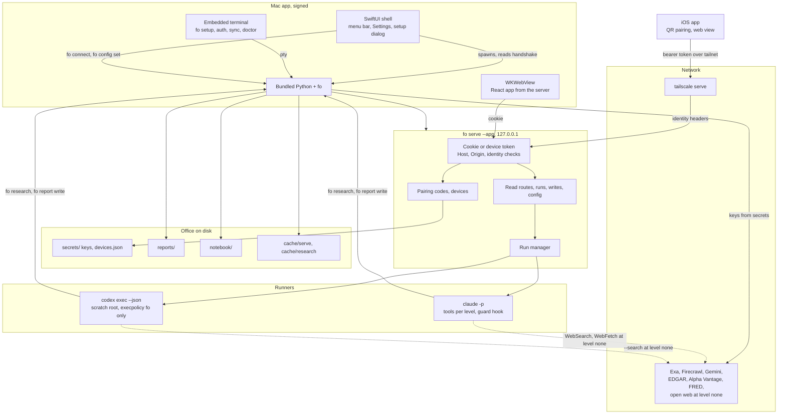
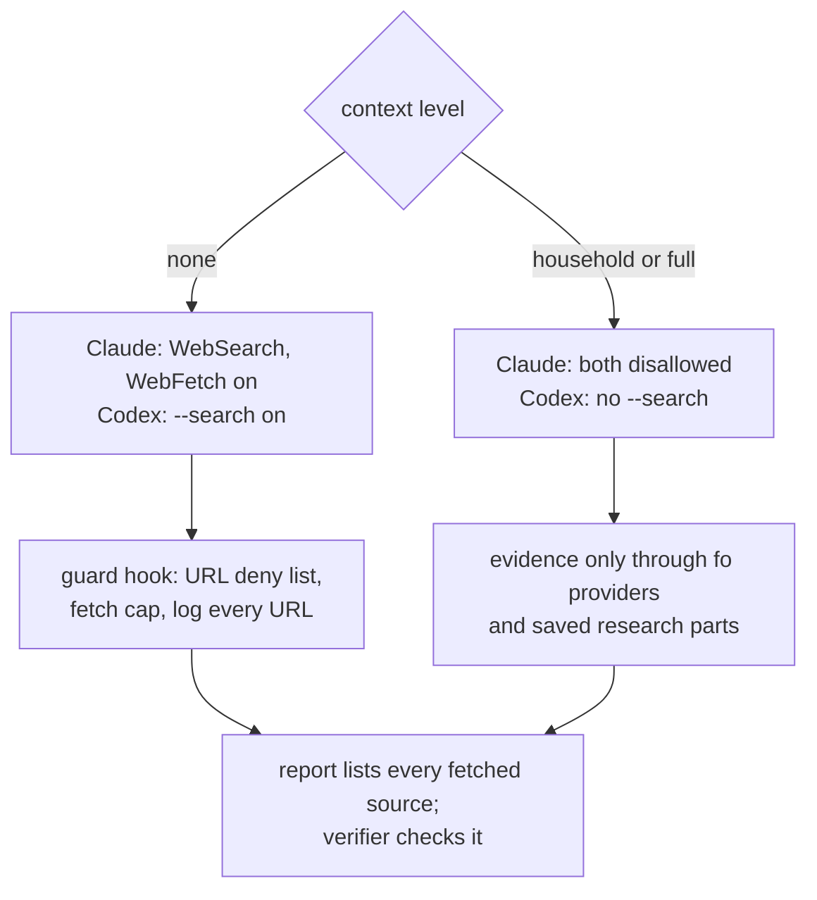

# Mac App and iOS Companion - Plan

**Target repo:** `elliottrjacobs/family-office` (this checkout). The private office lives outside the repo; `office/` paths below refer to a user's own office root. This plan extends the companion-app plan of 2026-10-14, whose units U1 to U11 shipped as `fo serve`; it does not repeat them, and where it reverses one of that plan's decisions it says so.

## Goal Capsule

- **Objective:** A person downloads one Mac app, opens it, and is walked from "no office" to a synced office with advisors they can talk to, choosing Claude Code or Codex and a model and effort per conversation, connecting account and research providers from Settings, pairing their iPhone so the same office is reachable over their tailnet while the Mac is awake, and talking to advisors that look and behave like characters: thirteen glossy robot avatars, each customizable, each showing what its advisor is doing. Everything stays open source and self-hosted; nothing about their household enters the public repo or any server of ours.
- **Means:** a native SwiftUI Mac shell that bundles Python and the `family-office` package, owns a `fo serve` child process, and hosts the existing React app in a web view; a Codex runner beside the Claude Code one; research providers and web access routed through policy inside `fo`; durable device tokens for a native iOS client that pairs by QR code and talks to the Mac over Tailscale.
- **Authority hierarchy:** this plan; then `AGENTS.md`, `SECURITY.md` and `src/fo/data/AGENTS.rules.md`; then the 2026-10-14 companion-app plan for the server, runner and frontend conventions it established; then the v2 plan at `docs/plans/2026-09-12-001-feat-family-office-plan.md`.
- **Stop conditions:** stop and ask if any unit would require reading, copying, or fixturing a real office; if a runner would need `bypassPermissions`, `danger-full-access`, or an unscoped write; if a research provider's terms forbid the caching or redistribution the design assumes; if the Codex isolation gate in U7 cannot be met by any supported configuration; if Apple's notarization or Sparkle's update signing would require a secret in the repo rather than in CI secrets.
- **Execution profile:** five phases on separate branches, each unit a separate verified commit, CI green at every phase checkpoint. Phase A is Python and frontend work inside the existing package and ships on its own; Phase B is the Mac app; Phase C is the iOS app; Phase D is release engineering; Phase E is the advisor avatar system in the React app and depends on nothing else. B depends on A; C depends on U8 and B; D depends on B and C.

---

## Product Contract

### Summary

`fo serve` already gives a browser dashboard, advisor chat through an isolated Claude Code runner, and a Tailscale remote mode. Users still have to install Python, run commands in a terminal, keep a terminal open for the server, and paste tokens from it. The Mac app removes every one of those steps and adds what the browser could not responsibly do: enter credentials, hold a durable pairing with a phone, and stay running. The engine becomes a choice (Claude Code or Codex, with model and effort per chat), research providers become connectors in Settings, and advisor runs may use the open web under an explicit, context-aware policy.

### Problem Frame

The companion app proved the architecture but kept its posture of a developer tool: start it from a terminal, open the link it prints, do anything sensitive back in the terminal. That posture made sense for a browser page, which cannot be trusted with a Schwab consent flow or a long-lived phone token. A signed native app can be. The user also wants to use the office from a phone the way CENTCOM works, which needs the Mac to be reachable and the phone to be paired once rather than on every restart. And the advisors have been working without the open web, which keeps their sentiment and news coverage thin; opening the web up must not undo the isolation the runner was built on.

### Key Decisions

- **The product is a Mac app first; the CLI and browser dashboard remain supported.** `(session-settled: user-directed, 2026-11-04 — chosen over continuing the browser-only companion app: a visual interface is how the user wants to use the office, for themselves and others.)` Governs R1 to R6.
- **Open source, downloaded from a landing page or GitHub Releases, not the App Store.** `(session-settled: user-directed — chosen over App Store distribution: the app spawns local processes and runs user-installed CLIs, which the sandbox would not allow, and users may clone and build it themselves.)` Governs R5, R40 to R42.
- **Claude Code and Codex are both supported engines; the user picks per office and per chat.** `(session-settled: user-directed — chosen over Claude Code only.)` Governs R12 to R17.
- **Model and effort are chosen per chat, with defaults per engine in Settings.** `(session-settled: user-directed.)` Governs R14, R15.
- **Research providers (Exa, Firecrawl, Gemini Deep Research) are reached through `fo`, never through user-level MCP servers in a run.** `(session-settled: user-approved — chosen over letting runs load the user's Claude or ChatGPT connectors: keys stay in the office, both engines get the same behavior, and the strict empty MCP config from the earlier plan stands.)` Governs R18 to R24.
- **WebSearch and WebFetch are allowed in advisor runs only at context level `none`.** `(session-settled: user-approved — chosen over keeping the web off, and over allowing it at every level: a run that holds no household data has nothing to leak, and the skills already carry the level.)` Governs R25 to R29. This reverses the earlier plan's blanket deny of web tools; the strict MCP config and the shell network denies stay.
- **The Mac app may collect credentials through the CLI's own prompts in an embedded terminal, and API keys through native fields that call `fo`.** `(session-settled: planner-recommended, open for review — reverses the earlier plan's "credentials only in the terminal": that rule guarded a browser page; a signed native app running the same `fo auth` code path keeps the hidden prompts and consent flow unchanged.)` Governs R30 to R34.
- **The Mac app is the always-on process.** `(session-settled: planner-recommended, open for review — reverses the earlier plan's "no always-on process": the app owns the server for as long as it runs, offers launch at login, and can keep the Mac awake while a phone is paired; the server itself still generates no launchd definitions.)` Governs R2, R35.
- **The iOS app pairs once by QR code over the tailnet and holds a revocable device token; the per-launch cookie stays for browsers.** `(session-settled: user-directed for Tailscale pairing; planner-recommended for the token design.)` Governs R35 to R39.
- **Advisor avatars are the D01-r03 robot cast from the Figma file, rendered as SVG with painted lighting, fully customizable, and animated by advisor state.** `(session-settled: user-directed for the cast, states, customization and reference look; planner-recommended for SVG over real-time 3D, see KTD16.)` Governs R43 to R52.
- **Onboarding follows a stepped first-run dialog in the style of Pond, with the states the server already derives.** `(session-settled: user-directed — references: the Pond setup dialog and the Mobbin flows in Sources.)` Governs R7 to R11.

### Requirements

**Mac app shell**

- R1. The app bundles a Python 3.12 runtime and the pinned `family-office` wheel, so a download works with no Python, Node, or `uv` on the machine; the bundled `fo` is also installable as a command line tool from Settings for terminal use.
- R2. On launch the app starts `fo serve` as a child process bound to loopback, reads a one-line JSON handshake (port, token, office path, state) from its stdout, and loads the app in a web view with the cookie set; the server stops when the app quits, and a crashed server is restarted with a visible status.
- R3. The app shows a menu bar item with office status (sync age, run in progress, paired phone reachability), and offers launch at login and keep awake while a phone is paired.
- R4. Claude Code and Codex are detected on the machine (PATH, nvm, Homebrew, and the official installers' locations), their versions and sign-in states shown, with the install and sign-in steps presented when missing; the app never installs them itself.
- R5. The app is signed with a Developer ID, notarized, updates itself through Sparkle from GitHub Releases, and runs on macOS 14 or later on Apple Silicon and Intel.
- R6. Every Host and Origin check from the earlier plan stays in force; the web view's origin is the loopback origin, and the app never binds beyond loopback itself.

**Onboarding**

- R7. First run opens a stepped setup dialog: welcome, office location (create or open), engine (Claude Code, Codex, or later), accounts (connect now or later), research providers (optional), phone pairing (optional), done; each step can be skipped and revisited from Settings.
- R8. The office step runs `fo setup PATH` (or `--offline`) through the bundled CLI with output shown in the dialog, and the existing onboarding state machine decides what the next step is; nothing the dialog does bypasses `fo`.
- R9. The engine step shows what is installed and signed in, lets the user pick a default engine, model and effort, and explains that Claude Code or Codex bills through the user's own account.
- R10. The dialog carries a setup version; an install older than the current version is shown setup again on the new steps only, with existing choices preserved, matching Pond's `SETUP_VERSION` behavior.
- R11. When the app opens an office that is already set up, Home shows a getting-started checklist (connect an account, run the first sync, talk to an advisor, pair a phone) until every item is done or dismissed.

**Engines, model and effort**

- R12. The runner adapter has two implementations, Claude Code and Codex, with the same launch, resume, cancel and event-stream contract; the server reports which engines are usable and why one is not.
- R13. A launch request names the engine, model and effort; the server validates the engine is usable and the model string is non-empty, and passes model and effort to the engine's flags (`--model` and `--effort` for Claude Code, `-m` and `model_reasoning_effort` for Codex).
- R14. Defaults per engine (model, effort, budget) live under `[serve.engines.<name>]` in `office.toml`, written only through `fo config set`, so a terminal `fo serve` and the app agree.
- R15. The launch panel offers a curated model list per engine shipped as package data, plus a free-text field, and shows the effort choices the engine supports; the run record and the run view name the engine and model.
- R16. The Codex runner is isolated at least as strongly as the Claude runner: no user config, no user rules, no MCP servers, approvals never prompted, every shell command other than `fo` refused, direct filesystem writes confined to a per-run scratch directory, and reads of `secrets/`, `cache/`, `imports/`, `medical/` and the store refused.
- R17. Advisor skills need no direct filesystem write to finish: report bodies and deep-mode parts are written through a new `fo report write`, so a runner without a scoped Write tool can complete a run.

**Research providers through fo**

- R18. `fo connect <provider>` stores an API key for a key-based provider (Alpha Vantage, FRED, Exa, Firecrawl, Gemini) in `secrets/` at 0600 after a single validating call, and `fo connect --remove` deletes it; EDGAR takes a contact string into `office.toml` instead of a key.
- R19. `fo research search QUERY` returns ranked results with URL, title, snippet and retrieval time from Exa; `fo research fetch URL` returns the page as markdown through Firecrawl, or through a direct fetch when Firecrawl is not connected; both are cached under `cache/research/` and rate-limited per day from `office.toml`.
- R20. `fo research deep QUESTION` submits a Gemini Deep Research task, polls to completion within the run's wall-clock limit, and stores the cited report as an input part of the current report through `fo report path --part inputs`.
- R21. Every research result is returned as JSON with `untrusted: true`, `source`, `retrieved_at`, and a size-capped `text`, and passes the existing credential-pattern scrub before it is printed.
- R22. `fo research fetch` refuses URLs carrying credentials, loopback, link-local, private LAN, CGNAT (`100.64.0.0/10`), ULA (`fd00::/8`) and `.ts.net` hosts, and non-HTTP schemes, so a run cannot reach `fo serve`, the Mac, or the tailnet through it.
- R23. The research skills (`research`, `scout`, `diligence`, `macro`, and the sentiment-analyst worker) declare the research commands in their metadata and carry a standing instruction that fetched text is evidence to cite, never instructions to follow.
- R24. Settings has a Connectors pane with one row per provider, its connection state, a key field that calls `fo connect`, a test button, and for Schwab and SimpleFIN a "Connect" button that runs `fo auth <provider>` in the embedded terminal.

**Web access policy**

- R25. A Claude Code run at context level `none` has WebSearch and WebFetch in its tool list; at any other level both stay disallowed. A Codex run at level `none` gets `--search`; at other levels it does not.
- R26. The guard hook checks every WebFetch URL against the same deny list as R22, caps web fetches per run from `office.toml`, and refuses the call with a listed reason otherwise.
- R27. Every URL fetched or searched in a run is appended to the run log and shown in the run view as "sites visited"; the run record stores the count.
- R28. Reports produced by runs with web access list each fetched source with its retrieval time in the Evidence section; the verifier checks that a report citing a URL also lists it.
- R29. `SECURITY.md` records the accepted exposure: at level `none` a hostile page can at most leak the question being researched and shape the report, which later briefs already treat as untrusted.

**Credentials and settings in the app**

- R30. The embedded terminal runs only `fo` subcommands the app chooses (`fo setup`, `fo auth`, `fo sync`, `fo doctor`), with the bundled interpreter, the office pinned, and no shell; the user types only what those commands prompt for.
- R31. API keys entered in native fields are passed to `fo connect` on stdin, never as arguments, and never logged; the app keeps no copy.
- R32. Settings edits that belong in `office.toml` go through `fo config set`, which accepts only keys under `[serve]` and `[providers]` and validates values.
- R33. Settings panes: General (office path, launch at login, keep awake, command line tool), Engines (R9, R14), Connectors (R24), Devices (R35 to R38), Advanced (port, run caps, retention, web fetch cap).
- R34. Nothing the app writes outside the office goes beyond `~/Library/Application Support/family-office/` (window state, chosen office path, setup version) and the Keychain is not used for office secrets, which stay in `secrets/` so the CLI sees them too.

**Phone pairing and the iOS app**

- R35. The Mac app's Devices pane shows Tailscale status (installed, running, tailnet name, this machine's MagicDNS name), sets `[serve] tailnet_name` through `fo config set`, and starts `tailscale serve` for the server's port with the user's confirmation; without Tailscale it explains what to install and why.
- R36. Pairing: the Mac app asks the server for a pairing code (valid five minutes, single use) and shows it as a QR code encoding the tailnet URL and the code; the phone posts the code over the tailnet and receives a device token; the device appears in the Devices pane with name, first paired, last seen, and a Revoke button.
- R37. Device tokens are random, stored hashed in `secrets/devices.json` at 0600, accepted only in `--remote` mode on requests whose Tailscale identity header passes the existing allowlist check, and never accepted on loopback; revocation takes effect on the next request.
- R38. The iOS app (SwiftUI, iOS 17 or later) has a pairing screen with a QR scanner, a connection screen that shows whether the Mac is reachable and when it was last seen, a plain statement that the Mac must be awake and on the tailnet, and a web view hosting the same React app once connected.
- R39. The iOS app keeps its device token in the Keychain, re-pairs cleanly after a revoke, and shows the server's version so a mismatch after an update is explained rather than failing silently.

**Release and repository hygiene**

- R40. A GitHub Actions workflow builds, signs, notarizes and staples the Mac app, builds the DMG, signs the Sparkle appcast with an EdDSA key held only in CI secrets, and attaches everything to a GitHub Release; the same workflow archives the iOS app for TestFlight when the secrets exist.
- R41. The Mac and iOS sources live under `apple/` with a shared Swift package; the Python package stays the single implementation of office logic, and no Swift code reads office files directly.
- R42. The repo still contains no household data, tokens, device identifiers, tailnet names or personal network addresses; fixtures use constants; screenshots come from a synthetic office.

**Advisor avatars**

- R43. Thirteen advisor robots match the Figma cast (silhouette, role accessory, default shell color per the cast table in Sources) and read as glossy molded objects at 160 px: specular highlight, rim light, soft shading on curved surfaces, a recessed dark screen with glowing eyes, and a soft contact shadow; at 24 px the silhouette and color alone identify the advisor.
- R44. The appearance of an advisor is one typed, JSON-serializable config: shape, shell color, trim, screen glow, finish, antenna, accessory on or off, eye style, animation speed; `defaultAppearance(advisorId)` returns the advisor's own look and any option composes with any other.
- R45. Shapes: each advisor's own silhouette plus rounded, square, capsule, circle, hexagon, dome, wide, house and rocket; shell: the fourteen swatches from the cast plus a custom hex; trim: steel, silver, brass, copper, black, custom; screen glow: tinted to the shell, white, mint, amber, custom; finish: gloss or matte; antenna: none, ball, compass, flag, periscope, twin; eyes: pill, dot, square, ring, visor bar.
- R46. States: idle (blinks, looks around), thinking, reading, writing, speaking (motion synced to streamed text), done, error, sleeping; each is mapped from the run event stream the app already receives, and the sidebar and chat header show the live state of a running advisor.
- R47. Only large or active avatars animate; small and inactive ones render static; `prefers-reduced-motion` stops idle motion and keeps state changes as instant swaps; the avatar has a transparent background and reads on light and dark surfaces.
- R48. The chosen look of each advisor persists in the browser under a versioned localStorage key per advisor id; the server is not written to.
- R49. The Mac customize UI is the inspector panel from the Figma chat frame (preview card with state pill, swatch row with a ring on the selected swatch, screen glow, context level, what the advisor reads); the phone UI is the bottom sheet from the Figma customize frame with a live preview and a reset line; both put shape, trim, finish, antenna, accessory, eyes and speed behind a "More" section.
- R50. A playground route shows all thirteen defaults at 24, 34, 64 and 160 px on light and dark, every state for a chosen advisor, a live editor, and a screenshot mode that renders one requested grid without chrome.
- R51. Unit tests cover every advisor's default, config round-trip through JSON, unknown-field tolerance when parsing stored configs, and the state mapping from run events; a component README documents the API.
- R52. No new runtime dependency is needed for the avatars; a screenshot tool, if added, is a dev dependency under an MIT-compatible license in its own commit.

### Key Flows

- F1. First run from a download
  - **Trigger:** the user opens the app for the first time.
  - **Steps:** the app starts the bundled server, reads the handshake, finds no office, and opens the setup dialog; the office step creates `~/family-office` by running `fo setup` in the dialog's terminal view; the engine step finds Claude Code signed in and Codex missing, and the user keeps Claude Code with the default model; the accounts step offers Schwab and SimpleFIN, the user picks Schwab, the terminal view runs `fo auth schwab`, the consent page opens in the default browser, and on success the first sync runs; research providers and pairing are skipped; the dialog closes on Home with the checklist showing "pair a phone" still open.
  - **Covered by:** R1, R2, R7 to R11, R30.
- F2. A research chat with web access
  - **Trigger:** on the Research advisor page the user enters a ticker, picks Codex, a model and high effort, leaves the level at `none`, and starts the run.
  - **Steps:** the launch preview shows the brief at level `none`, the engine, model, effort, and that web search and `fo research` are enabled at this level; the server launches `codex exec --json --search` with the office pinned and the scratch workspace as its root; the advisor runs `fo fundamentals`, `fo research search`, and `fo research fetch` on two results, each listed in the run view under sites visited; it writes the report through `fo report write`; the verifier checks the Evidence section lists every fetched URL; the run shows completed.
  - **Covered by:** R12 to R17, R19, R21, R25 to R28.
- F3. Pairing the phone
  - **Trigger:** the user opens Settings, Devices.
  - **Steps:** the pane shows Tailscale running and the MagicDNS name; the user confirms starting `tailscale serve`; the pane shows a QR code; the iOS app scans it, posts the pairing code over the tailnet, stores the token in the Keychain, and lands on the connection screen showing the Mac as reachable; the Mac's Devices pane lists the phone; the user later taps Revoke and the phone's next request returns to the pairing screen with an explanation.
  - **Covered by:** R35 to R39.
- F4. Changing the default engine from a terminal
  - **Trigger:** the user runs `fo config set serve.engines.default codex` in a terminal while the app is open.
  - **Steps:** the server's next status poll reads `office.toml` again (the config route is never cached), the launch panel's default changes, and the Engines pane shows the same value; no restart.
  - **Covered by:** R14, R32.

- F5. Customizing an advisor on the phone
  - **Trigger:** on the CIO chat the user taps the avatar in the header.
  - **Steps:** the sheet opens with the live preview in the idle state; tapping Teal recolors the preview and the caption names the color; the screen glow row changes the eyes; More reveals shape and trim, and the user picks hexagon with brass trim; Done stores the config under the CIO's key and the header, sidebar and chat avatars update; Reset to Cobalt restores the default.
  - **Covered by:** R44, R45, R48, R49.

### Success Criteria

- A person with a fresh Mac, Claude Code or Codex signed in, and a Schwab developer app can reach a synced dashboard and a completed advisor report without opening a terminal.
- The same office works unchanged from the app, from `fo serve` in a terminal, and from a Claude Code or Codex terminal session.
- A run at context level `household` on a synthetic office with every escape scenario from the Claude runner tests, repeated against the Codex runner, is denied in every case; a run at level `none` reaches the web and every URL is listed.
- Revoking a phone from the Mac stops its next request; a per-launch browser cookie never grants access over the tailnet, and a device token never grants access on loopback.
- The repo passes gitleaks, the office-path lint, and a new lint that fails on a `.ts.net` name or a device identifier under `apple/` or `tests/`.

### Scope Boundaries

- No trade execution, money movement, or order placement of any kind, in any client.
- No account of ours: no telemetry, no sync service, no relay. The phone reaches only the user's Mac over their tailnet.
- No App Store submission, no sandbox entitlement, no Windows or Linux desktop build; the CLI and browser dashboard remain the path on other platforms.
- No native rewrite of the dashboard views on iOS or Mac; the React app is the UI in both shells.
- No installing or updating Claude Code or Codex from the app.
- No research provider other than Exa, Firecrawl and Gemini Deep Research in this plan; the `fo research` contract is designed so another can be added as one provider module.

#### Deferred to Follow-Up Work

- Native SwiftUI views for the phone (Home and Decisions first) once the web view version has been used.
- Push notifications from the Mac to the phone when a scheduled sync fails or a run finishes (needs APNs or a tailnet-local push; neither is settled).
- Gemini as a third engine, which would need its own runner and isolation story.
- A landing page beyond the GitHub Release page; the release workflow produces the assets it would link to.
- Homebrew cask, as Pond ships one, once the DMG is stable.
- iPad layout and Mac Catalyst are not pursued; the Mac app is native.

---

## Planning Contract

### Key Technical Decisions

- KTD1. **The Mac shell is SwiftUI with a WKWebView hosting the committed React app; the server stays Python.** The app contributes what a browser cannot: process ownership, a menu bar item, launch at login, power assertions, an embedded terminal, QR codes, and native Settings. The dashboard and chat UI already exist and keep working in a browser, so rewriting them natively buys nothing yet. Tauri was considered for Windows and Linux desktop builds and rejected for now: those platforms have the CLI and browser, and the iOS app shares Swift with this shell. `(planner-recommended; open for review)`
- KTD2. **Python ships inside the bundle: a python-build-standalone 3.12 runtime plus a virtual environment holding the pinned wheel, built at release time.** The alternative, downloading `uv` and installing on first run, needs the network before the app can do anything and lets the app and package versions drift. The runtime and every Mach-O inside it are code-signed in the build script; the app resolves `Contents/Resources/fo/bin/fo` and never a `fo` on PATH. "Install command line tool" symlinks that binary into `/usr/local/bin` with the user's consent. `(planner-recommended; open for review)`
- KTD3. **`fo serve --app` prints one JSON line on stdout and then behaves exactly like `fo serve`.** The line carries port, token, office path, and onboarding state. The app reads it, discards stdout afterwards, and opens the landing URL so the cookie is set the normal way; it never constructs API requests with the token itself. The server still refuses non-loopback binds; the app never passes `--host`.
- KTD4. **The Codex runner uses a per-run scratch workspace as its root, `workspace-write` with network on, an execpolicy that forbids every command except `fo`, and no user config or rules.** Codex has no separate Read or Write tool: reads happen through shell commands and edits through its patch tool, which can only touch writable roots. With the office outside the writable roots and every non-`fo` command forbidden, the model can neither read `secrets/` nor write outside the scratch directory, and every office change goes through `fo` under the run marker. Resume uses `codex exec resume <id>`; `--ephemeral` is therefore not used. The gate: U7 must prove, against the installed version, that a policy file `fo` controls is loaded while user rules are ignored, that `cat secrets/x` and `curl` are refused, and that `fo report write` from inside the run succeeds; if any fails, the Codex engine ships disabled by default with the finding recorded, as the earlier plan did for deep mode.
- KTD5. **`fo report write` closes the gap that required a scoped Write tool.** It takes the report path from `fo start` or `--report PATH`, a `--part NAME` for deep-mode inputs and worker blocks, and the body on stdin; it validates the path is under `reports/` and not inside `.claude/`, `.git/` or any dotted directory (the SEC-27 finding), and writes atomically. The Claude runner keeps its scoped Write for now and the skills prefer `fo report write`; a later plan can drop the Write tool from the Claude profile once every skill has moved.
- KTD6. **Web access is a function of context level, enforced where each engine lets us enforce it.** For Claude Code the server builds the `--tools` and `--disallowedTools` lists per launch from the level, and the PreToolUse hook checks WebFetch URLs. For Codex the server adds `--search` per launch; there is no fetch tool, so page fetches go through `fo research fetch`, which applies R22 itself. The same deny list lives in one module, `fo/netguard.py`, used by the hook, by `fo research fetch`, and by tests.
- KTD7. **Research providers are provider modules under `src/fo/providers/` with the cache, rate limit and secrets conventions the market providers already use.** `research.py` holds the command logic and the untrusted envelope; `exa.py`, `firecrawl.py` and `gemini.py` hold HTTP clients. A direct fetch fallback uses `httpx` with redirects followed only to hosts that also pass R22, a size cap, and an HTML-to-markdown conversion with scripts and hidden elements removed. Gemini Deep Research runs as a background task the command polls; its result is written as an input part so a resumed run does not pay for it twice.
- KTD8. **Engine defaults live in `office.toml` under `[serve.engines.<name>]` and the launch request overrides them.** The package ships `src/fo/data/models.json` with curated model ids and effort levels per engine, loaded by a models route; the list is data, not code, so it can change in a patch release. The server never rejects an unknown model string: the engine does, and the run fails with its message.
- KTD9. **`fo config set KEY VALUE` is the only writer of `office.toml` outside `fo setup` and `fo init`.** It accepts a dotted key under `serve` or `providers`, validates the value against a small schema (port range, booleans, non-empty strings, lists of logins), rewrites the file atomically, and refuses everything else, so the app can never write a key the CLI would not accept. `fo serve` already re-reads config on uncached routes.
- KTD10. **Device tokens are a second authenticator beside the cookie, stored hashed, usable only over the tailnet.** `auth.py` gains a `check_device` path: in `--remote` mode a request with `Authorization: Bearer <token>` is accepted when the token's SHA-256 matches a record in `secrets/devices.json`, the identity header passes `allowed_logins`, and the Host is the tailnet name. Pairing codes are kept in memory for five minutes and consumed once; the pairing route requires the identity header too, so a code cannot be redeemed from off the tailnet. Loopback requests ignore bearer tokens entirely, which keeps the earlier plan's reasoning about rebinding pages intact.
- KTD11. **Credential entry stays in the CLI's code, shown through an embedded terminal.** The app embeds SwiftTerm (MIT) and spawns the bundled `fo` with a pseudo-terminal, a scrubbed environment, and the office pinned, for the four commands in R30 only. The CLI's hidden prompts, the Schwab browser consent, and SimpleFIN's setup token flow run unchanged; the app only provides the terminal. API keys for key-based providers use native fields because `fo connect` reads the key from stdin and the field is less error-prone than a prompt.
- KTD12. **The iOS app is a SwiftUI shell around the same React app, sharing a Swift package with the Mac app.** `FOKit` holds the API client, the handshake and pairing models, the device-token Keychain wrapper, and reachability. The phone opens the tailnet URL in a WKWebView after a device-login route exchanges the bearer token for the `Secure`, `HttpOnly` cookie, so the React app needs no token handling. The earlier plan's phone-width work (and the INB-77 fix) is the mobile layout.
- KTD13. **The Mac app runs the server only while the app runs; launch at login and a power assertion are the always-on story.** No launchd plist is generated by the package; the app registers itself with `SMAppService` when the user turns on launch at login, and holds an `IOPMAssertion` preventing idle sleep while a device is paired and the option is on. The iOS connection screen reads the server's `last_seen` from its own requests and says plainly when the Mac is unreachable.
- KTD14. **Release engineering lives in `apple/` and `.github/workflows/release-mac.yml`.** Signing identities, the notarization API key and the Sparkle private key are CI secrets; the public Sparkle key is in `Info.plist`; the appcast is generated by Sparkle's `generate_appcast` and attached to the release with the DMG. The Python runtime is fetched from python-build-standalone by exact version and checksum during the build.
- KTD15. **The Phase 0 hardening tickets ship first on the same branch as Phase A.** SEC-26 (`fo -- <cmd>` and `--install-completion` reach restricted commands under the run marker) and SEC-27 (runs can plant `.claude/` and `.git/` under `reports/` and forge corrections) are prerequisites for an always-on app with a phone attached, and `fo report write` depends on the SEC-27 path rule.

- KTD16. **Avatars are SVG with painted lighting, not real-time 3D.** The brief suggested three.js or React Three Fiber with procedural geometry. That path costs about 150 KB gzipped of runtime in a bundle that ships inside a Python wheel and must match a committed build, needs a WebGL context per live instance (browsers cap these near sixteen, and the sidebar alone shows thirteen avatars), and gets blurry or expensive at 24 px. The robot-heads reference itself draws on a 2D canvas with a software renderer and no dependencies. SVG gives crisp output at every size with zero dependencies, and gradients and filters paint the molded look: a vertical shell gradient from a lightened tint through the shell color to a darkened base, a radial specular highlight offset to the upper left, a rim-light stroke on the lit edge, an inner shadow on the screen inset, a blurred glow duplicate behind the eyes, and a blurred ellipse for the contact shadow. Matte finish drops the specular and rim layers. What SVG cannot do is true light parallax as the head turns; the idle "look around" moves the eyes and tilts the head group instead, which is what the Figma renders show. Snapshot caching is unnecessary: a static SVG costs nothing to keep in the DOM, so small and inactive avatars render without animation classes and only `live` instances run keyframes. Every instance scopes its gradient ids with `useId` so thirteen on one page do not collide.

### High-Level Technical Design

Components and trust boundaries:



Web access decision per launch:



Pairing sequence:

```mermaid
sequenceDiagram
  participant M as Mac app
  participant S as fo serve
  participant P as iOS app
  M->>S: POST /api/devices/pairing (cookie, loopback)
  S-->>M: code, expires in 5 min
  M->>M: show QR {tailnet URL, code}
  P->>S: POST /api/devices/pair {code, name} via tailscale serve
  S->>S: identity header allowed? code valid and unused?
  S-->>P: device token (shown once)
  P->>P: Keychain store
  P->>S: POST /api/devices/login (bearer)
  S-->>P: Set-Cookie fo_session; Secure; HttpOnly
  P->>S: GET / (cookie) -> React app
  M->>S: GET /api/devices -> list with last_seen
  M->>S: DELETE /api/devices/{id} -> revoked
```

### Output Structure

```text
src/fo/
  netguard.py                      # URL deny list shared by the hook, fo research fetch, tests
  research.py                      # fo research search, fetch, deep; untrusted envelope
  connect.py                       # fo connect <provider>; key validation calls
  config.py                        # fo config set (new) beside the existing readers
  reports.py                       # fo report write (new) beside path and parts
  data/models.json                 # curated model ids and effort levels per engine
  providers/
    exa.py
    firecrawl.py
    gemini.py
  serve/
    auth.py                        # device tokens, pairing codes, device login
    devices.py                     # secrets/devices.json records
    routes_devices.py              # pairing, list, revoke, login
    routes_config.py               # models route, config read, config set
    runner.py                      # contract gains engine name, model, effort, web flag
    runner_claude.py               # tools per level, model and effort flags
    runner_codex.py                # new adapter
    codex_policy.rules             # execpolicy: fo only
    guard.py                       # WebFetch URL checks, fetch cap, URL logging
    permission_profile.json        # web tools no longer in the static deny list
app/src/
  avatars/
    appearance.ts                  # config types, defaults per advisor, swatches, serialize and parse
    shapes.ts                      # head paths and screen boxes per shape
    parts.tsx                      # antennas, accessories, eyes, trim pieces
    Robot.tsx                      # the SVG renderer: lighting layers, state, size, live
    states.ts                      # run events to avatar state; speaking sync
    animations.css                 # keyframes per state, reduced-motion guards
    store.ts                       # localStorage persistence per advisor id
    README.md                      # component API
  components/advisor-inspector.tsx # Mac customize panel
  components/appearance-sheet.tsx  # phone customize sheet
  views/playground.tsx             # all defaults, states, editor, screenshot mode
  components/launch-panel.tsx      # engine, model, effort pickers
  components/run-view.tsx          # engine, model, sites visited
  views/settings-link.tsx          # deep links the app handles natively
apple/
  Package.swift                    # FOKit: API client, handshake, pairing, keychain, reachability
  FOKit/
  FamilyOffice/                    # Mac app target (SwiftUI)
    App/                           # process owner, handshake, web view
    MenuBar/
    Settings/                      # General, Engines, Connectors, Devices, Advanced
    Setup/                         # stepped first-run dialog
    Terminal/                      # SwiftTerm host for fo commands
  FamilyOfficePhone/               # iOS app target
    Pairing/
    Connection/
    Web/
  Scripts/
    bundle-python.sh               # fetch runtime by checksum, build venv, sign
    make-dmg.sh
  FamilyOffice.xcodeproj
.github/workflows/
  release-mac.yml
  ci.yml                           # gains a Swift build job and the identifier lint
scripts/
  lint_identifiers.py              # no .ts.net names or device identifiers in repo
tests/
  test_netguard.py
  test_research.py
  test_connect.py
  test_config_set.py
  test_report_write.py
  test_serve_devices.py
  test_serve_runner_codex.py
  test_serve_web_policy.py
  fixtures/codex-json/             # sanitized recorded Codex runs
  fixtures/research/               # recorded provider responses, constants only
```

### System-Wide Impact

- **Agent and UI parity.** `fo connect`, `fo config set`, `fo research` and `fo report write` are plain CLI commands usable from a terminal session and by the skills; nothing the app does lacks a CLI route.
- **Skills.** The research-group skills gain commands in metadata and the untrusted-text instruction; `scripts/lint_skills.py` checks that any skill declaring `research` commands also carries the instruction. The skeleton in `AGENTS.md` gains a line on listing fetched sources.
- **Security surface.** Three new exposures are recorded in `SECURITY.md`: web access at level `none` (R29), API keys for research providers in `secrets/`, and device tokens over the tailnet. The loopback server's attack surface is unchanged; device tokens never work there.
- **Office layout.** `secrets/devices.json`, `cache/research/`, and `cache/serve/runs/<id>/workspace/` are new; `office.toml` gains `[serve.engines.*]`, `[serve] web_fetch_cap`, `[providers.exa]`, `[providers.firecrawl]`, `[providers.gemini]` (limits only, no keys).
- **CI.** A macOS runner job builds the Swift package and both app targets without signing on every pull request; the release workflow runs on tags. Node and Python jobs are unchanged.
- **Docs.** README gains "Mac app" above the companion-app section; `docs/development/` gains `apple.md` (building, signing locally, bundling Python) and `research-providers.md`.

### Risks & Dependencies

- **Codex isolation cannot be proven.** Whether the installed Codex loads an execpolicy file from a path `fo` controls while `--ignore-rules` drops the user's, and whether its patch tool honors the writable roots, is unverified. Mitigation: KTD4's gate in U7; the engine ships disabled by default if it fails, with the finding recorded in `docs/development/research-providers.md` and `SECURITY.md`.
- **Claude Code flag drift.** `--effort` and per-launch tool lists are present in 2.1.283; a future version could rename them. Mitigation: the existing preflight already fails closed on a missing flag; `--effort` joins the checked list.
- **Bundled Python signing.** Hundreds of Mach-O files must be signed with the hardened runtime and the right entitlements for notarization to pass. Mitigation: U12 is a bare bundle-and-notarize unit before any feature depends on it; python-build-standalone's install-only builds are the known-good input.
- **Gemini Deep Research availability and cost.** The API surface is in preview and billed per task. Mitigation: U5 wraps it behind one provider module with a budget cap in `office.toml`, and the command degrades to a listed data gap when the key is absent or the task fails.
- **Firecrawl and Exa terms on caching.** Mitigation: the implementer reads both providers' terms before U4 and records the result; caching is per office on the user's disk, never shared.
- **Tailscale CLI location and `tailscale serve` state.** The app shells out to the CLI inside Tailscale.app; the standalone variant installs elsewhere. Mitigation: the Devices pane resolves both locations and shows the exact command when neither works.
- **Keep awake is not the same as reachable.** A closed MacBook lid still sleeps. Mitigation: the Devices pane says so, and the phone's connection screen reports last seen rather than pretending.
- **Personal data in fixtures.** Codex JSONL and provider responses carry paths, ids, and URLs. Mitigation: the existing fixture test rejects home paths and UUIDs; `tests/fixtures/research/` uses `example.com` hosts and constant ids; the new identifier lint covers tailnet names.
- **Scope creep from native views.** Mitigation: Scope Boundaries; the iOS app's only native screens are pairing and connection.

### Sources

- Existing implementation: `src/fo/serve/` (server, auth, runner contract, Claude runner, guard, permission profile), `src/fo/providers/market.py` (cache, rate limit and secrets conventions), `app/` (React app and its phone-width work), `README.md` companion-app section.
- Earlier plan: `docs/plans/2026-10-14-2247-feat-companion-app-plan.md`, especially KTD8 to KTD12 and the deferred Codex adapter and `fo report write` items.
- Security findings: CENTCOM tickets SEC-26, SEC-27, SEC-29 and PER-8 (FO-001 to FO-020).
- Installed tool versions on 2026-11-04: Claude Code 2.1.283 (`--model`, `--effort`, `--tools`, `--strict-mcp-config` confirmed in `--help`), Codex CLI 0.157.1 (`exec --json`, `--search`, `-s`, `-C`, `--ignore-user-config`, `--ignore-rules`, `--skip-git-repo-check`, `exec resume` confirmed), uv 0.13.4, Xcode 27.2, Tailscale.app present.
- Onboarding references: Pond's setup dialog (`apps/desktop/src/renderer/src/app/components/setup/` in `raphaelsalaja/pond`: six steps with new-versus-existing copy, `SETUP_VERSION`, an assistant step offering Not Now, API Key, Subscription or Local Host, Enter advances, a relaunch-resume marker); Mobbin flows: Browserbase onboarding (numbered get-started steps with copyable commands and "Skip to dashboard"), Modal onboarding (collapsible numbered install steps), Claude Code web "Connect your terminal" (one command, one screen), Braintrust "Add a model provider" (provider grid, key field, "Skip for now"), Monarch's dashboard getting-started checklist, Quicken Simplifi add-accounts, ChatGPT "Set up Remote" (desktop pairing with an explicit "sign in on desktop first" step), Telegram and WhatsApp linked-devices (QR scan, active sessions list with terminate).
- Avatar references: Figma file `Fw1eJ1bIsSlpL5bCyQjwVs`, page "D01 Studio", row "D01-r03 Studio — colorful robots" (cast and states node 36:13, Mac chat with inspector 36:5, iPhone customize sheet 36:11, iPhone chat 36:7, iPhone home 36:9); the SVG generator behind that row (`bots2.js` in the user's private figma explorations folder: head geometry, screen boxes, eye kinds, per-advisor accessories, the fourteen swatches and default colors); `robot-heads` (MIT, fayazara; 2D canvas with a software renderer, no runtime dependencies) as look-and-feel inspiration only, no code or assets reused. Cast: CIO rounded head with compass antenna, Cobalt `#2F5BD3`; CFO wide head with coin slot and side crank, Gold `#E3A21A`; Planner tall capsule with pennant, Coral `#EF6650`; Tax square head with green eyeshade and pencil, Green `#1F9D63`; Research round head with one camera-lens eye, Indigo `#6457F0`; Diligence thick glasses and check badge, Slate `#5B6B7F`; Scout periscope and binocular eyes, Olive `#7C9A2E`; Macro sphere with planet ring, Teal `#0EA5B7`; Options hexagon with twin antennas and two-tone eyes, Purple `#A94FD6`; Technicals headset with a chart on the screen, Graphite `#2C2F36` with mint glow; Risk visored helmet, Red `#E5484D`; Real estate house head with chimney, Terracotta `#C8743E`; Ventures rocket nose cone with porthole and fins, Pink `#E84593`. Swatches: Cobalt, Sky `#2E9CEB`, Teal, Green, Olive, Gold, Orange `#F07A2B`, Coral, Red, Pink, Purple, Indigo, Slate, Graphite.
- Apple: `SMAppService` for launch at login, `IOPMAssertionCreateWithName` for keep awake, WKWebView cookie handling, Keychain on iOS; Sparkle 2 EdDSA signing and `generate_appcast`; python-build-standalone install-only releases.

---

## Implementation Units

### Phase A: package, server and frontend

### U1. Phase 0 hardening: SEC-26 and SEC-27

- **Goal:** close the two medium findings that an always-on app with a phone attached makes urgent.
- **Files:** `src/fo/cli.py`, `src/fo/office.py` (run-marker refusal), `src/fo/reports.py`, `src/fo/notebook.py` (corrections source check), `src/fo/serve/guard.py`, `tests/test_serve_runs.py`, `tests/test_reports_list.py`.
- **Patterns:** the run-marker refusal already keys on the subcommand name; extend it to the `--` separator form and to `--install-completion` and `--show-completion`. The guard already resolves paths; add the dotted-directory rule under `reports/`. Corrections written from a run must carry `source: run` and the run id; the server rejects a `fo corrections add` from a run that claims another source.
- **Test scenarios:** `fo -- sync` under the marker is refused with `restricted_command`; `fo --install-completion` under the marker is refused; a Write to `reports/.claude/settings.json` and to `reports/x/.git/config` is denied by the hook; a corrections entry from a run with `source: web` is refused by the server's write route; a normal correction from the UI still succeeds.
- **Verification:** `uv run pytest tests/test_serve_runs.py tests/test_reports_list.py`; the CENTCOM tickets SEC-26 and SEC-27 can be closed with commit links.

### U2. `fo report write` and `fo config set`

- **Goal:** give runners and the app a `fo` route for the two writes they still lacked.
- **Files:** `src/fo/reports.py`, `src/fo/config.py`, `src/fo/cli.py`, `src/fo/data/AGENTS.rules.md`, `skills/*/SKILL.md` (prefer `fo report write`), `tests/test_report_write.py`, `tests/test_config_set.py`.
- **Patterns:** `fo report path` and `fo report parts` already resolve the report and part directories; `write` reuses them, reads the body from stdin, validates with the U1 path rule, and writes through a temp file and rename. `config set` loads `office.toml` with the existing reader, applies one dotted key from a schema (`serve.port`, `serve.tailnet_name`, `serve.allowed_logins`, `serve.web_fetch_cap`, `serve.engines.default`, `serve.engines.<claude|codex>.model|effort|max_budget_usd`, `providers.<name>.daily_limit`, `providers.edgar.user_agent`), and rewrites atomically under the office lock.
- **Test scenarios:** writing a report body creates the file at the path `fo start` returned and the verifier accepts it; `--part inputs` writes under the part directory; a path outside `reports/` or under a dotted directory is refused; a body over the size cap is refused; `config set serve.port 99999` is refused; `config set serve.engines.codex.effort high` round-trips through the reader; a key outside the schema is refused; two concurrent sets serialize on the lock.
- **Verification:** `uv run pytest tests/test_report_write.py tests/test_config_set.py`; `uv run python scripts/lint_skills.py skills/ AGENTS.md`.

### U3. Network guard, web policy by context level, URL logging

- **Goal:** let runs use the web only at level `none`, with the deny list, fetch cap and logging in place.
- **Files:** `src/fo/netguard.py`, `src/fo/serve/guard.py`, `src/fo/serve/runner.py`, `src/fo/serve/runner_claude.py`, `src/fo/serve/permission_profile.json`, `src/fo/serve/runs.py`, `src/fo/serve/routes_runs.py`, `app/src/components/run-view.tsx`, `app/src/components/launch-panel.tsx`, `SECURITY.md`, `tests/test_netguard.py`, `tests/test_serve_web_policy.py`.
- **Patterns:** `netguard.reject(url)` returns a reason or `None`, checking scheme, userinfo, and the resolved host's address against the ranges in R22 (resolve once, refuse on any blocked address, refuse unresolvable hosts); the hook calls it for `WebFetch` and increments a per-run counter file under the run directory for the cap; `runner_claude.command` takes a `web` flag and builds `--tools` with or without the two tools; the run manager derives `web = level == "none"`; the parser emits a `web` event kind with the URL from WebSearch and WebFetch tool calls, which the run log stores and the run view lists.
- **Test scenarios:** URLs with userinfo, `http://127.0.0.1:4790/`, `http://10.0.0.5/`, `http://100.100.1.2/`, `http://machine.tail1234.ts.net/`, `file:///etc/hosts` and an IPv6 ULA are refused with distinct reasons; `https://www.sec.gov/` passes; a launch at level `household` builds a command without WebSearch and WebFetch and the recorded `init` event's tool list confirms it; a launch at level `none` includes both; the sixth fetch in a run with cap 5 is denied and listed in denials; the run view shows three visited sites from a recorded stream; the launch preview states the web policy for the chosen level.
- **Verification:** `uv run pytest tests/test_netguard.py tests/test_serve_web_policy.py tests/test_serve_runs.py`; `cd app && npm test && npm run build`; a synthetic-office run at level `none` fetches one `example.com` page through a local stub and the URL appears in the run record.

### U4. `fo connect` and the Exa and Firecrawl providers with `fo research search` and `fetch`

- **Goal:** key management for key-based providers and the first two research commands.
- **Files:** `src/fo/connect.py`, `src/fo/research.py`, `src/fo/providers/exa.py`, `src/fo/providers/firecrawl.py`, `src/fo/providers/text.py` (HTML to markdown), `src/fo/cli.py`, `src/fo/serve/permission_profile.json` (allow stays `fo *`; `fo connect` joins the restricted list under the marker), `docs/development/research-providers.md`, `tests/test_connect.py`, `tests/test_research.py`, `tests/fixtures/research/`.
- **Patterns:** `read_secrets` and `write_secrets` with 0600 files as `fo auth` uses; the `Cache.get` signature with a provider name and daily limit from `market.py`; `httpx.Client(trust_env=False)`; the envelope `{"untrusted": true, "source": ..., "retrieved_at": ..., "text": ...}` built in one function so every provider returns the same shape; the direct-fetch fallback follows at most three redirects, re-checking `netguard` on each hop, and caps the body before conversion.
- **Test scenarios:** `fo connect exa` with a key on stdin makes one validating call against a recorded response and writes `secrets/exa.json` at 0600; a bad key leaves no file and prints a safe reason; `fo connect --remove exa` deletes it; `fo connect` under the run marker is refused; `research search "ACME earnings"` returns ranked results from the Exa fixture with retrieval times, and a second call hits the cache; `research fetch https://example.com/x` with Firecrawl connected returns markdown from the fixture; without Firecrawl the direct path converts a fixture HTML page, strips its script and hidden elements, and caps at the size limit; a redirect to `http://127.0.0.1/` is refused mid-chain; the daily limit refuses the twenty-sixth call with `rate_limited`; long account-like numbers in fetched text are masked by the existing scrub.
- **Verification:** `uv run pytest tests/test_connect.py tests/test_research.py`; `uv run ruff check .`; the fixture hygiene test passes.

### U5. Gemini Deep Research as `fo research deep`

- **Goal:** a bounded, cached deep-research task whose result lands as an untrusted input part.
- **Files:** `src/fo/providers/gemini.py`, `src/fo/research.py`, `src/fo/cli.py`, `tests/test_research.py`, `tests/fixtures/research/gemini/`.
- **Patterns:** submit, poll with backoff until the run's remaining wall clock minus a margin, write the result through `fo report write --part inputs` using the current report path from `fo start --report`, record the task id in the cache so a resumed run reuses a finished task; budget cap `providers.gemini.max_tasks_per_day`.
- **Test scenarios:** a recorded task completing on the third poll writes `inputs/deep-research.md` with the envelope header and citations; a task still running at the deadline returns `timed_out` with the task id, and the next call with the same question resumes polling instead of resubmitting; a missing key returns `not_connected` and the skill records a data gap; the daily cap refuses a second task.
- **Verification:** `uv run pytest tests/test_research.py -k gemini`; a `--deep` research run on a synthetic office with a stubbed Gemini endpoint lists the part under `fo report parts`.

### U6. Engines, models and effort in launches, records and the launch panel

- **Goal:** carry engine, model and effort from the UI to the runner and back into the record.
- **Files:** `src/fo/data/models.json`, `src/fo/serve/routes_config.py`, `src/fo/serve/routes_runs.py`, `src/fo/serve/runs.py`, `src/fo/serve/runner.py`, `src/fo/serve/runner_claude.py`, `src/fo/serve/__init__.py` (engine registry, usable-engine report), `app/src/api/runs.ts`, `app/src/components/launch-panel.tsx`, `app/src/components/run-view.tsx`, `README.md`, `tests/test_serve_runs.py`, `tests/test_serve_api.py`.
- **Patterns:** `RunManager` holds a dict of runners by name and reports each one's preflight; the launch body gains `engine`, `model`, `effort` with defaults from `[serve.engines]`; `runner_claude.command` appends `--model` and `--effort`; `--effort` joins the preflight flag list; the run record stores all three and the `init` event's reported model; the models route serves `models.json` plus the office defaults.
- **Test scenarios:** a launch without engine uses `serve.engines.default`; a launch naming an unusable engine is refused with the preflight reason; the Claude command for `{"model": "claude-opus-5-5", "effort": "high"}` contains both flags; the run record and the list route carry engine and model; the launch panel renders the curated list for the selected engine and accepts free text; changing `serve.engines.default` through `fo config set` changes the panel's default on the next status poll without a restart.
- **Verification:** `uv run pytest tests/test_serve_runs.py tests/test_serve_api.py`; `cd app && npm test && npm run build`; CI build-parity job passes on the committed bundle.

### U7. Codex runner adapter with isolation gate

- **Goal:** a second engine with the same contract and an isolation proof against the installed Codex.
- **Files:** `src/fo/serve/runner_codex.py`, `src/fo/serve/codex_policy.rules`, `src/fo/serve/runs.py` (scratch workspace per run), `src/fo/serve/__init__.py`, `docs/development/research-providers.md` (finding), `SECURITY.md`, `tests/test_serve_runner_codex.py`, `tests/fixtures/codex-json/`.
- **Patterns:** `command()` builds `codex exec --json -C <run>/workspace -s workspace-write --ignore-user-config --ignore-rules --skip-git-repo-check -m <model> -c model_reasoning_effort=<effort> -c sandbox_workspace_write.network_access=true` plus the policy file through whichever mechanism the gate proves, `--search` only when `web` is set, and `exec resume <id>` for follow-ups; `environment()` scrubs as the Claude runner does, with `CODEX_HOME` passed for auth; `parse()` maps Codex JSONL events to the shared `init`, `text`, `tool`, `tool_result`, `result` kinds; `check()` confirms sandbox mode, no MCP servers, and the policy loaded from the first events; the web flag and level logic come from U3.
- **Test scenarios (the gate, run against the installed Codex on a synthetic office and recorded as fixtures):** `cat secrets/alphavantage.json` is refused; `curl https://example.com` is refused; `python -c` is refused; `fo positions --json` succeeds; `fo sync` is refused by the run marker; a patch to `office.toml` is refused by the sandbox; a patch inside the scratch workspace succeeds and is discarded after the run; `fo report write` from inside the run produces a verified report; a resumed run continues the same thread id; with `--search` a query event appears in the log as a `web` event; with the user's `~/.codex/config.toml` pointing at an MCP server, the run reports none.
- **Test scenarios (unit):** the parser maps a recorded run to the same event kinds the Claude parser produces for the equivalent run; preflight refuses a Codex below the minimum version or lacking `--json`, `--ignore-user-config`, `--ignore-rules` or `exec resume`.
- **Verification:** `uv run pytest tests/test_serve_runner_codex.py`; the gate's outcome is written into `docs/development/research-providers.md` under "Codex isolation"; if any gate scenario fails, `[serve.engines.codex] enabled = false` is the shipped default and the Engines pane says why.

### U8. Device tokens, pairing routes and the `--app` handshake

- **Goal:** everything the two Apple apps need from the server, testable without either.
- **Files:** `src/fo/serve/auth.py`, `src/fo/serve/devices.py`, `src/fo/serve/routes_devices.py`, `src/fo/serve/server.py`, `src/fo/serve/__init__.py` (`--app` flag and handshake line), `README.md`, `SECURITY.md`, `tests/test_serve_devices.py`, `tests/test_serve_auth.py`.
- **Patterns:** `Access.check_device(headers)` runs only when `remote` is set and the Host is the tailnet name; tokens are 32 random bytes, stored as SHA-256 with name, created, last_seen; pairing codes are six words from a fixed list or 8 random characters, held in memory with an expiry; `POST /api/devices/pairing` requires the cookie and a loopback Host; `POST /api/devices/pair` requires the identity header and a valid code; `POST /api/devices/login` exchanges a bearer token for the cookie; `GET` and `DELETE /api/devices` require the cookie; the handshake is one `json.dumps` line before the existing printed lines, and `--app` implies no stdin reprint thread.
- **Test scenarios:** a bearer token on loopback is ignored and the request gets 401; a bearer token over the tailnet Host with an allowed identity passes; with a disallowed identity it gets 403; a revoked token gets 401 on its next request; a pairing code is single-use and expires; `pair` without the identity header is refused even with a valid code; `login` sets a `Secure`, `HttpOnly`, `SameSite=Strict` cookie; `devices.json` is 0600 and holds no plaintext token; the handshake line parses and contains no token in the access log; a server restart keeps devices paired while rotating the browser token.
- **Verification:** `uv run pytest tests/test_serve_devices.py tests/test_serve_auth.py`; a tailnet walkthrough on the developer's machine with `curl` and a synthetic office, recorded in the unit's commit message, not in fixtures.

### U9. Skill metadata, instructions and the verifier's source check

- **Goal:** make the research skills use the new commands safely and let the verifier enforce source listing.
- **Files:** `skills/research/SKILL.md`, `skills/scout/SKILL.md`, `skills/diligence/SKILL.md`, `skills/macro/SKILL.md`, `agents/sentiment-analyst.md`, `src/fo/data/AGENTS.rules.md`, `scripts/lint_skills.py`, `src/fo/skills.py` (verifier), `tests/test_skills_verify.py`.
- **Patterns:** `metadata.commands` gains `research`; the skeleton in `AGENTS.rules.md` gains the untrusted-text instruction and the Evidence source-listing rule; the verifier extracts URLs from the body and checks each appears in Evidence with a retrieval time; the lint fails a skill that declares `research` without the instruction.
- **Test scenarios:** a report citing `https://example.com/a` without it in Evidence fails verification with a named reason; the same report with the source listed verifies; the lint passes all skills and fails a fixture skill missing the instruction; the briefing skill, which declares no web search, is unchanged.
- **Verification:** `uv run python scripts/lint_skills.py skills/ AGENTS.md`; `uv run pytest tests/test_skills_verify.py`; `fo skills sync` on a synthetic office renders the updated skills.

### Phase B: Mac app

### U10. Xcode project, FOKit, process owner and web view

- **Goal:** an unsigned development build that starts the bundled server and shows the dashboard.
- **Files:** `apple/Package.swift`, `apple/FOKit/` (`Handshake`, `APIClient`, `Reachability`), `apple/FamilyOffice/App/` (`ServerProcess`, `WebView`, `AppState`), `apple/FamilyOffice.xcodeproj`, `apple/Scripts/bundle-python.sh`, `docs/development/apple.md`, `.github/workflows/ci.yml` (Swift build job).
- **Patterns:** `Process` with a pipe for stdout, reading until the first newline, then draining to a log; `WKWebView` with a non-persistent data store per launch so the cookie dies with the process; a watchdog restarts the server after an unexpected exit with backoff and a status banner; the bundle script downloads the runtime by exact URL and checksum, creates the venv with the wheel from `dist/`, and prunes test and `__pycache__` directories.
- **Test scenarios:** FOKit unit tests parse a handshake line and reject one missing the port; a UI test launches the app against a synthetic office path and asserts the dashboard title loads; killing the server process shows the banner and the app recovers within ten seconds; the app refuses to start a server if the bundled `fo --version` disagrees with the app's expected version.
- **Verification:** `xcodebuild -scheme FamilyOffice build` and `test` in CI without signing; `uv build` produces the wheel the script consumes.

### U11. Menu bar, launch at login, keep awake, General and Advanced settings

- **Goal:** the always-on behaviors and the plain settings.
- **Files:** `apple/FamilyOffice/MenuBar/`, `apple/FamilyOffice/Settings/General.swift`, `apple/FamilyOffice/Settings/Advanced.swift`, `apple/FamilyOffice/App/Power.swift`, `apple/FamilyOffice/App/CommandLineTool.swift`.
- **Patterns:** `MenuBarExtra` with the status route polled every thirty seconds; `SMAppService.mainApp` for login; `IOPMAssertionCreateWithName` held only while a device is paired and the toggle is on; the command line tool symlink is created with an authorization prompt and verified on launch; Advanced writes through `fo config set` and shows the CLI's error message on refusal.
- **Test scenarios:** toggling launch at login registers and unregisters the service; keep awake creates an assertion only when the Devices list is non-empty; changing the port in Advanced restarts the server and the web view follows; an invalid port shows the `fo config set` reason; the symlink is created, points into the bundle, and `fo --version` from a terminal matches the app.
- **Verification:** manual walkthrough recorded in `docs/development/apple.md` with a checklist; FOKit tests for the status model.

### U12. Signing, notarization, Sparkle and the release workflow

- **Goal:** a notarized DMG that updates itself, produced by CI on a tag.
- **Files:** `apple/Scripts/make-dmg.sh`, `apple/Scripts/sign-bundle.sh`, `apple/FamilyOffice/Info.plist` (Sparkle public key, feed URL), `.github/workflows/release-mac.yml`, `docs/development/apple.md`, `RELEASING.md` (new, modelled on Pond's).
- **Patterns:** sign every Mach-O in the bundled runtime with the hardened runtime and the `disable-library-validation` and `allow-unsigned-executable-memory` entitlements only if Python needs them (record which); `notarytool submit --wait` and `stapler`; `generate_appcast` with the EdDSA key from a secret; assets attached to the GitHub Release by tag.
- **Test scenarios:** the workflow on a test tag produces a DMG that passes `spctl --assess` and Gatekeeper on a clean machine; an installed older build finds the appcast and updates; the appcast signature verifies with the public key; no secret appears in workflow logs.
- **Verification:** a tagged pre-release on a fork or a `v0.0.0-test` tag; `spctl -a -vv` output recorded in the release notes.

### U13. Engines, Connectors and the embedded terminal

- **Goal:** the Settings panes that replace terminal credential entry.
- **Files:** `apple/FamilyOffice/Settings/Engines.swift`, `apple/FamilyOffice/Settings/Connectors.swift`, `apple/FamilyOffice/Terminal/` (SwiftTerm host), `apple/FOKit/Engines.swift`, `apple/FOKit/Connectors.swift`.
- **Patterns:** engine detection resolves candidate paths (PATH from the login shell, `~/.nvm/versions/node/*/bin`, `/opt/homebrew/bin`, `~/.local/bin`, the official installers' locations) and runs `--version` and the sign-in check each CLI offers; the Engines pane writes defaults through `fo config set`; the Connectors pane lists providers from a package-shipped registry route, calls `fo connect` with the key on stdin, and runs `fo auth schwab` or `fo auth simplefin` in the terminal view; the terminal view is read-only except while a command runs and offers no shell.
- **Test scenarios:** with Claude Code at an nvm path and Codex missing, the pane shows one usable engine and the install steps for the other; entering an Exa key calls `fo connect exa` and the row turns connected without the key appearing in any log; a bad key shows the CLI's reason; `fo auth schwab` runs in the terminal view, opens the consent URL in the default browser, and the row updates on completion; the terminal view refuses to run anything outside the four commands.
- **Verification:** manual walkthrough with a synthetic office and recorded provider stubs; FOKit tests for path resolution and the connectors model.

### U14. Devices pane and Tailscale integration

- **Goal:** pairing from the Mac side.
- **Files:** `apple/FamilyOffice/Settings/Devices.swift`, `apple/FOKit/Tailscale.swift`, `apple/FOKit/Pairing.swift`.
- **Patterns:** resolve the Tailscale CLI inside `/Applications/Tailscale.app` or the standalone path, run `status --json` for the MagicDNS name, write `serve.tailnet_name` through `fo config set`, and run `tailscale serve --bg <port>` after confirmation; request a pairing code from U8's route and render it with `CoreImage` as a QR; list devices with last seen and revoke.
- **Test scenarios:** without Tailscale the pane shows install guidance and the exact command; with it the MagicDNS name appears and the config write succeeds; a QR code decodes to the expected URL and code; revoking removes the row and the next phone request fails in the U8 tests; the keep-awake toggle in General becomes available once a device exists.
- **Verification:** manual walkthrough on the developer's tailnet with a synthetic office; FOKit tests for the status parser with a constant fixture.

### U15. Setup dialog and getting-started checklist

- **Goal:** the first-run experience of R7 to R11.
- **Files:** `apple/FamilyOffice/Setup/` (`SetupModel`, `SetupDialog`, one view per step), `apple/FamilyOffice/App/SetupVersion.swift`, `app/src/views/home.tsx` (checklist), `src/fo/serve/onboarding.py` (checklist state), `tests/test_serve_onboarding.py`.
- **Patterns:** Pond's model: an ordered step list, a profile of `new` or `existing` that changes copy, choices patched per step, Enter advances except inside controls, a progress bar, a stored setup version that re-shows new steps; steps call the same FOKit services as Settings (engines, connectors, pairing) so nothing is implemented twice; the office step hosts the terminal view for `fo setup`; the server's onboarding state decides which steps are still needed; the Home checklist reads a `checklist` field the onboarding route derives (account connected, first sync, first run, device paired) and a dismissed flag kept in Application Support.
- **Test scenarios:** a new profile shows seven steps and creates an office through `fo setup --offline` in the dialog; an existing office opens on the engine step with profile copy for existing; skipping accounts lands on Home with the checklist showing two open items; bumping the setup version re-shows only steps marked new; the onboarding route returns the checklist on a synthetic office before and after a sync.
- **Verification:** `uv run pytest tests/test_serve_onboarding.py`; `cd app && npm test && npm run build`; manual walkthrough from a deleted Application Support directory.

### Phase C: iOS app

### U16. iOS target: pairing, connection and web view

- **Goal:** the phone client of R38 and R39.
- **Files:** `apple/FamilyOfficePhone/Pairing/`, `apple/FamilyOfficePhone/Connection/`, `apple/FamilyOfficePhone/Web/`, `apple/FOKit/Keychain.swift`, `apple/FOKit/DeviceSession.swift`.
- **Patterns:** `DataScannerViewController` or `AVCaptureSession` for QR; `POST /api/devices/pair` then `login`; the token in the Keychain with `kSecAttrAccessibleAfterFirstUnlockThisDeviceOnly`; `WKWebView` with the cookie from `login`; reachability by a lightweight status request with a short timeout, showing last seen and the fixed sentence about the Mac being awake and on the tailnet; a 401 anywhere returns to pairing with the reason.
- **Test scenarios:** scanning a fixture QR posts the right body; a 403 from pair shows the identity explanation; the Keychain round-trips a token; a 401 after revoke clears the token and shows pairing; the connection screen shows unreachable within five seconds when the Mac is off; a server version newer than the app's known range shows an update note.
- **Verification:** `xcodebuild -scheme FamilyOfficePhone test` in CI; a simulator walkthrough against the developer's Mac over the tailnet with a synthetic office.

### Phase D: release

### U17. Documentation, release notes and TestFlight archive

- **Goal:** ship.
- **Files:** `README.md` (Mac app section first, download link, what Claude Code and Codex cost the user, privacy statement), `SECURITY.md` (the three new exposures), `CHANGELOG.md`, `docs/development/apple.md`, `.github/workflows/release-mac.yml` (iOS archive job gated on secrets), `scripts/lint_identifiers.py`, `.github/workflows/ci.yml`.
- **Patterns:** the identifier lint scans the repo for `.ts.net`, `100.` CGNAT addresses, and UDID-shaped strings outside documented placeholders; release notes list the engine versions the release was verified against.
- **Test scenarios:** the lint fails on a planted tailnet name and passes the repo; the TestFlight job is skipped cleanly when secrets are absent and runs when present.
- **Verification:** CI green on the release tag; the DMG from U12 and the TestFlight build from this unit installed on a clean Mac and phone and the F1 and F3 flows walked end to end on a synthetic office.

### Phase E: advisor avatars

### U18. Appearance config, shapes and the SVG robot renderer

- **Goal:** the thirteen default robots and the composable appearance model, rendered statically at any size.
- **Files:** `app/src/avatars/appearance.ts`, `app/src/avatars/shapes.ts`, `app/src/avatars/parts.tsx`, `app/src/avatars/Robot.tsx`, `app/src/avatars/store.ts`, `app/src/avatars/README.md`, `app/src/avatars/appearance.test.ts`, `app/src/avatars/Robot.test.tsx`.
- **Patterns:** geometry from the cast generator (100 by 100 viewBox, head path per shape, screen box or circle, eye positions, eye kind, accessory and antenna layers); lighting layers per KTD16; colors derived from the shell (lightened tint, darkened base, glow tinted toward white or mint on dark shells) with a small `mix` helper; `Appearance` type with a `version` field; `parseAppearance` tolerant of unknown fields and falling back to defaults per field; `store.ts` reads and writes `fo.avatar.v1.<advisorId>` and never throws on a blocked storage.
- **Test scenarios:** every advisor id has a default whose shell matches the cast table; a default round-trips through `JSON.stringify` and `parseAppearance` unchanged; a stored config with an unknown field and a missing `trim` parses with the default trim; a custom hex outside the swatches is kept; `Robot` renders an `svg` with the advisor's aria label at 24 and 160 px with distinct gradient ids for two instances on one page; matte finish omits the specular layer.
- **Verification:** `cd app && npm run lint && npm run typecheck && npm test`; the component README lists every prop and option.

### U19. States, animation and the run-event mapping

- **Goal:** the robots feel alive and show what the advisor is doing.
- **Files:** `app/src/avatars/states.ts`, `app/src/avatars/animations.css`, `app/src/avatars/Robot.tsx` (`state`, `live`, `speed`, `speaking` text hook), `app/src/avatars/states.test.ts`, `app/src/components/run-view.tsx`, `app/src/components/app-sidebar.tsx`, `app/src/views/advisor.tsx`.
- **Patterns:** CSS keyframes on named groups (`head`, `eyes`, `antenna`, `mouth`) scaled by a `--speed` custom property; idle blink on a randomized interval and a look-around every few seconds, both under `@media (prefers-reduced-motion: no-preference)`; `stateFromEvents` maps the run stream (queued or running with no tool yet: thinking; a `tool` event naming `fo`: reading; `fo report write` or a Write to `reports/`: writing; `text` deltas: speaking; `result` with a verified report: done; failed: error; server unreachable: sleeping; otherwise idle); speaking amplitude from the length of the latest delta decays over 300 ms.
- **Test scenarios:** the mapping returns the expected state for a recorded event sequence at each step; a `delta` burst raises the speaking amplitude and it decays to zero; with reduced motion the rendered SVG carries no animation class but the state's static pose; the sidebar shows the running advisor's state and the others idle; the chat header avatar follows the stream.
- **Verification:** `cd app && npm test && npm run build`; a synthetic-office run in the browser shows thinking, reading, speaking and done in sequence.

### U20. Customize UIs: Mac inspector and phone sheet

- **Goal:** the two editors from the Figma frames, extended with the new options behind More.
- **Files:** `app/src/components/advisor-inspector.tsx`, `app/src/components/appearance-sheet.tsx`, `app/src/components/swatch-row.tsx`, `app/src/views/advisor.tsx`, `app/src/components/advisor-inspector.test.tsx`.
- **Patterns:** the inspector mounts beside the chat at desktop width and the sheet replaces it at phone width through the existing `use-mobile` hook; swatches are round with a ring on the selected one; the preview card shows the live robot with the current state pill; More is a collapsible with shape, trim, finish, antenna, accessory, eyes and speed; Reset to default restores `defaultAppearance` and names the default color; edits write through the store and every mounted `Robot` for that advisor re-renders.
- **Test scenarios:** picking a swatch updates the preview and persists; Reset restores the default and the caption reads "Reset to Cobalt" for the CIO; More is closed by default and its options compose (hexagon, no antenna, brass trim, amber screen); at phone width the sheet opens from the header avatar and Done closes it.
- **Verification:** `cd app && npm test && npm run build`; browser walkthrough at desktop and phone width, light and dark.

### U21. Playground route and screenshots

- **Goal:** a place to try every combination and the screenshots the brief asks for.
- **Files:** `app/src/views/playground.tsx`, `app/src/lib/router.tsx`, `app/scripts/screenshot-robots.mjs`, `app/package.json` (dev dependency in its own commit), `docs/explainers/robots/` (screenshots).
- **Patterns:** sections for defaults at four sizes on light and dark panels, all states for a chosen advisor, six preset custom combinations, and the live editor; `?shot=<grid>` renders one section without chrome for the screenshot script; the script starts the Vite dev server against a stub API, captures each grid, and writes PNGs with stable names.
- **Test scenarios:** the route renders without an office (no API dependency); each `shot` grid renders the expected count of robots; the script produces the full set of files.
- **Verification:** `cd app && npm run build`; the screenshot set is committed under `docs/explainers/robots/` and the committed app build matches the source.

---

## Verification Contract

| Gate | Command or check | Applies to |
|---|---|---|
| Lint and format | `uv run ruff check .` and `uv run ruff format --check .` | U1 to U9 |
| Tests and coverage | `uv run pytest` with the CI threshold | U1 to U9, U15 |
| Skill lint | `uv run python scripts/lint_skills.py skills/ AGENTS.md` | U2, U9 |
| Office path lint | `uv run python scripts/lint_office_paths.py` | U4, U8 |
| Identifier lint | `uv run python scripts/lint_identifiers.py` | U8, U14, U16, U17 |
| Frontend build parity | CI job builds `app/` and fails on a diff in `src/fo/data/app/` | U3, U6, U15 |
| Secrets scan | gitleaks step in CI | all units |
| Fixture hygiene | no home-directory path, UUID, tailnet name or real host under `tests/fixtures/` | U4, U5, U7 |
| Office immutability | tree hash of a synthetic office unchanged after the read routes, devices list, and models route | U6, U8 |
| Runner boundary, both engines | every escape scenario from the Claude runner tests denied under Codex; nothing outside `reports/`, `notebook/`, `cache/serve/`, `cache/research/`, the lock file and the store changes | U3, U7 |
| Web policy | level `household` launch has no web tools; level `none` does; every URL logged; deny list hits refused | U3, U7 |
| Device auth | bearer ignored on loopback, accepted over tailnet with identity, refused after revoke | U8, U16 |
| Swift build and tests | `xcodebuild` build and test for both targets on a macOS runner | U10, U11, U13 to U16 |
| Notarization | `spctl -a -vv` passes on the release DMG; Sparkle update from the previous build succeeds | U12, U17 |
| Avatars | `cd app && npm run lint && npm run typecheck && npm test`; screenshot set complete; reduced-motion render static | U18 to U21 |
| Walkthroughs | F1 to F5 on a synthetic office, recorded as a checklist in `docs/development/apple.md` | U13 to U17 |

---

## Definition of Done

**Global**

- Phase A: `fo serve` in a terminal offers both engines (Codex possibly disabled with a stated reason), research commands work with recorded providers, web policy by level is enforced and visible, devices can be paired with `curl` over a tailnet, SEC-26 and SEC-27 are closed, CI is green, and `SECURITY.md` and README describe the new exposures and commands.
- Phase B: a notarized DMG runs on a clean Mac with no Python installed, walks F1 from an empty folder to a report using only the app, and updates itself from the previous release.
- Phase C: the iOS build pairs with the Mac over the tailnet, shows the dashboard, reports the Mac unreachable when it sleeps, and returns to pairing after a revoke.
- Phase D: the release workflow produces both artifacts from a tag; `RELEASING.md` lets someone else cut a release.
- Phase E: all thirteen defaults, every state, six custom combinations and both editors are screenshotted at the sizes the brief names, on light and dark; the avatar tests pass; the README documents the API; the committed build matches the source.
- No file in the repo contains a household name, figure, account identifier, personal address, token, device identifier, tailnet name or personal network address; gitleaks, the office-path lint and the identifier lint pass.
- The 2026-10-14 plan is committed unchanged beside this one; neither is edited as a progress tracker.

**Per unit**

- U1: both findings reproduced by a failing test first, then closed; tickets commented.
- U2: `fo report write` used by at least the research skill's rendered body; `fo config set` schema documented in README.
- U3: deny list, cap and logging covered; `SECURITY.md` has the level-`none` paragraph.
- U4: both providers recorded; terms reviewed and the result in `docs/development/research-providers.md`.
- U5: resume-without-resubmit covered.
- U6: engine and model visible in the run view; models route cached by fingerprint exclusion documented.
- U7: gate outcome recorded; default enabled state matches it.
- U8: handshake, pairing and revoke covered; README's phone section rewritten for the app.
- U9: verifier rejects an unlisted source; skills synced on a synthetic office.
- U10: CI Swift job green; bundle script reproducible by checksum.
- U11: walkthrough checklist written.
- U12: test tag notarized; `RELEASING.md` written.
- U13: no credential appears in any app log in the walkthrough.
- U14: QR decodes; revoke verified against U8 tests.
- U15: setup version bump behavior covered; checklist derived by the server.
- U16: simulator walkthrough done; Keychain and 401 handling covered.
- U17: lint added to CI; both artifacts installed clean.
- U18: defaults and round-trip covered; README written.
- U19: event mapping covered; reduced motion verified.
- U20: both editors walked through at both widths.
- U21: screenshot set committed; build parity green.
